# Glass Activity Launcher

Activity Launcher с интерфейсом **Liquid Glass** (живое размытие фона, стеклянные плавающие панели, «жидкий» переключатель вкладок).
Jetpack Compose, Android **5.0+ (API 21+)**, русский + английский.

## Скачать

APK собирается GitHub Actions при каждом пуше и публикуется в [Releases](https://github.com/Korimuspast1/pr/releases?q=glass-launcher).

## Новое в 1.0.8

- **PRO активна навсегда ∞** — карточка подписки в настройках и значок PRO ∞ на главных экранах
- **Перетаскиваемая нижняя панель**: зажмите «каплю» и тащите влево/вправо, как на iPhone, — она растягивается, приподнимается, увеличивается и встаёт на ближайшую вкладку; порядок вкладок и стартовая вкладка настраиваются
- **Улучшенное стекло**: прозрачнее, блики по краям («преломление»), внутреннее свечение, цветной отблеск снизу; пресеты Кристалл / Прозрачное / Матовое / Плотное
- **Редактируется всё**: выбор приложения и активити из списка, тип запуска (Activity / Service / Foreground service / Broadcast), флаги вручную (hex/число), массивы в extras (string[]/int[]/long[]/float[]) и null, иконка из любой активити, другого приложения или галереи, дублирование избранного
- **Оформление**: свой цвет акцента (HSV + HEX), фон (жидкий / градиент / однотонный / своё фото с затемнением), скругление, размер текста и иконок, метки, счётчики, подписи вкладок, свои заголовки экранов, сброс оформления

## Функции

- **Все пакеты**: поиск по названию/пакету, фильтр пользовательские/системные, сортировка (имя, пакет, дата установки/обновления, число активити), счётчик активити
- **Глобальный поиск активити** по всем приложениям и **поиск по intent action** (кто принимает `SEND`, `VIEW`…)
- **Карточка пакета**: версия, target/min SDK, UID, даты, размер, установщик, путь APK, SHA-256 подписи; вкладки активити / сервисы / ресиверы / провайдеры / разрешения (с выдачей)
- Запуск приложения, системная инфо, Play Store, **извлечение и отправка APK**, удаление
- **Редактор ярлыка** (как в оригинале) + **конструктор интента**: action, data URI, MIME, категории, флаги, extras (string/int/long/bool/float/double/uri)
- Запуск, **запуск через root (su)** для неэкспортируемых активити, авто-root при отказе
- Ярлык на рабочий стол, поделиться, копировать **ADB-команду** и **intent URI**
- **Избранное** (порядок, правка) и **Недавние** (время, счётчик запусков); топ-4 избранных в меню долгого нажатия на иконку
- Экспорт/импорт избранного в JSON
- Настройки: тема, 7 акцентов + цвета обоев (Android 12+), сила размытия, плотность стекла, анимированный фон, компактный список, виброотклик, язык

## Скриншоты (эмулятор, автотест CI)

### Android 14 (API 34)
|  |  |  |  |
|---|---|---|---|
| 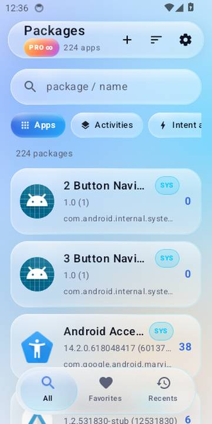 | 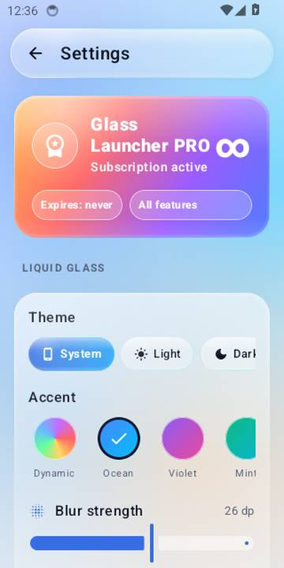 |  | 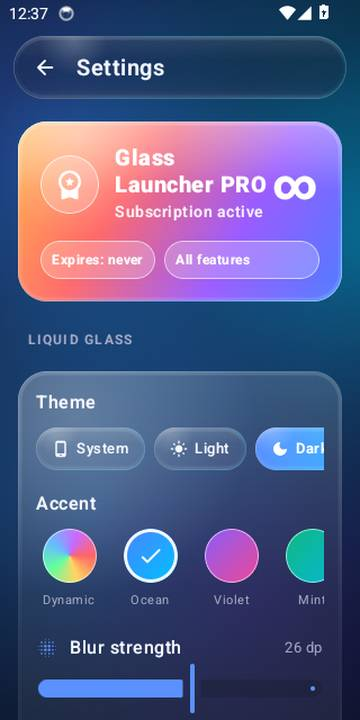 |
| 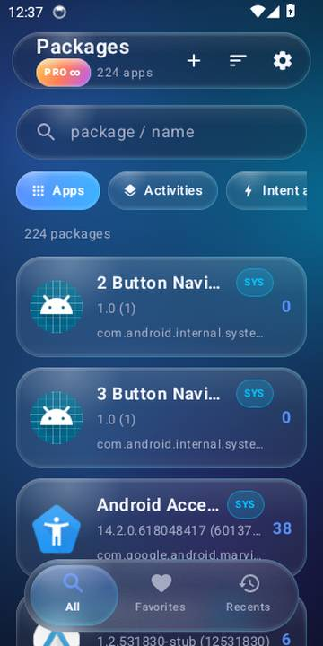 | 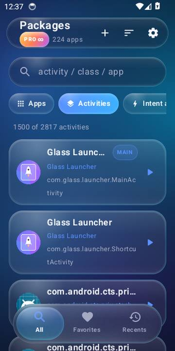 | 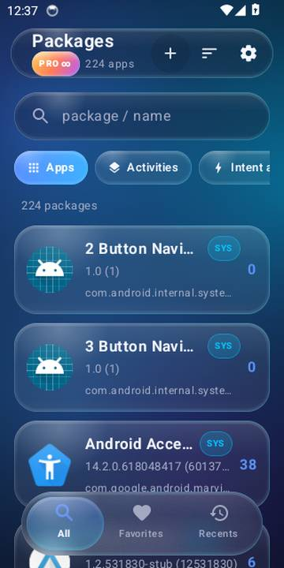 | 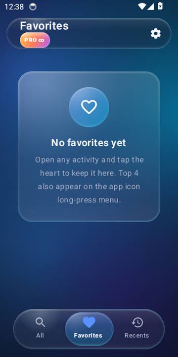 |
| 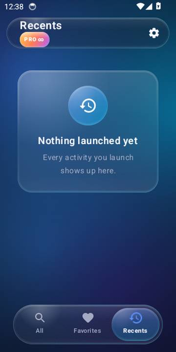 | 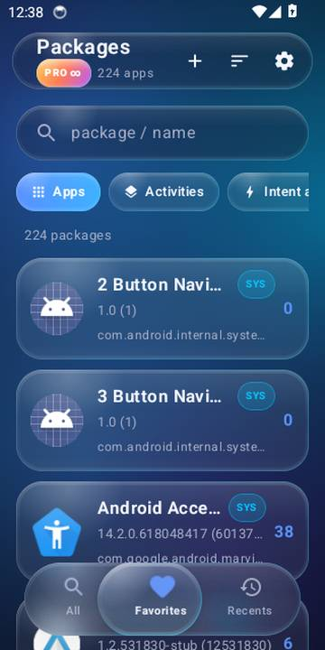 | 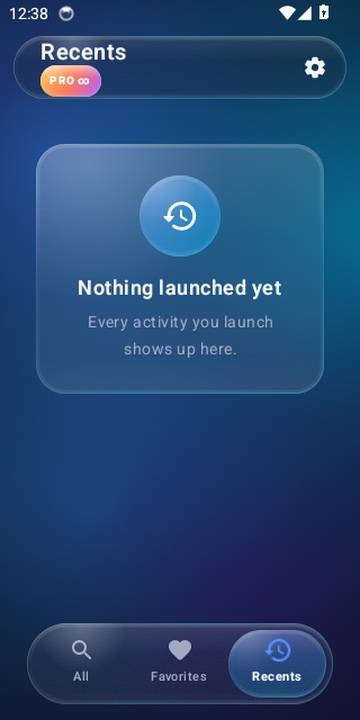 |

### Android 7.0 (API 24)
|  |  |  |  |
|---|---|---|---|
| 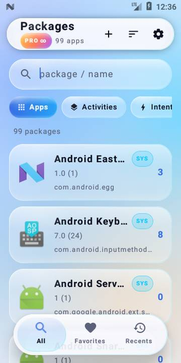 |  | 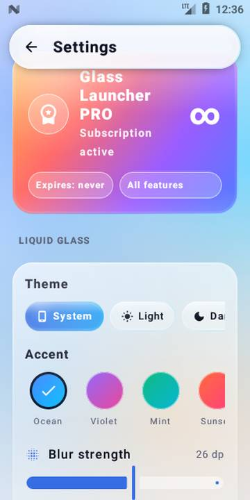 | 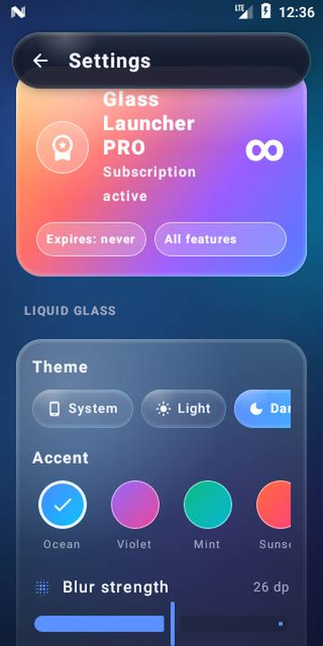 |
| 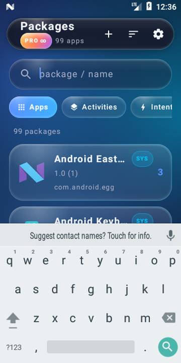 | 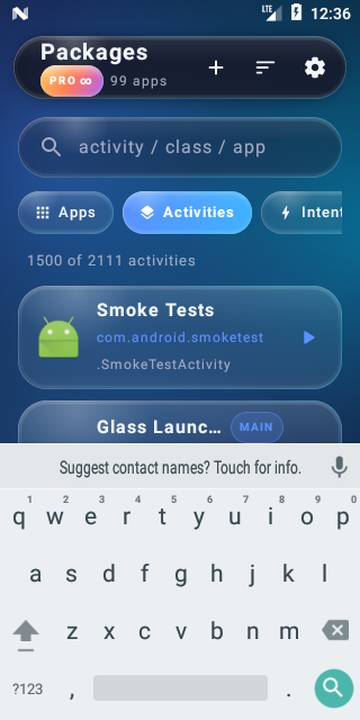 | 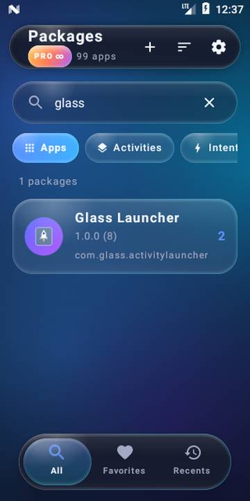 |  |
| 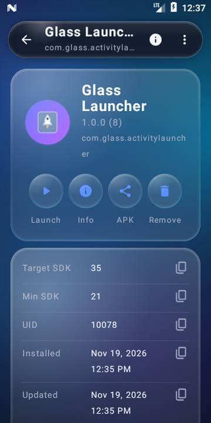 |  | 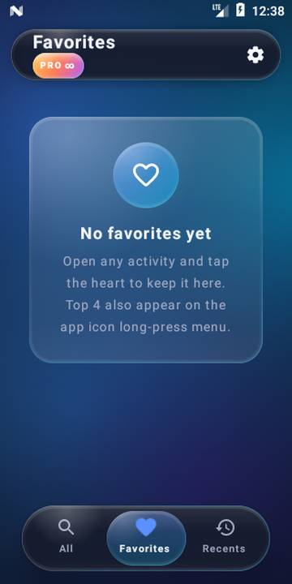 | 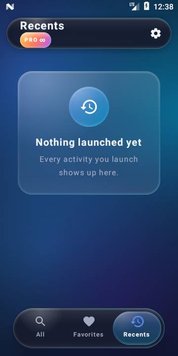 |
| 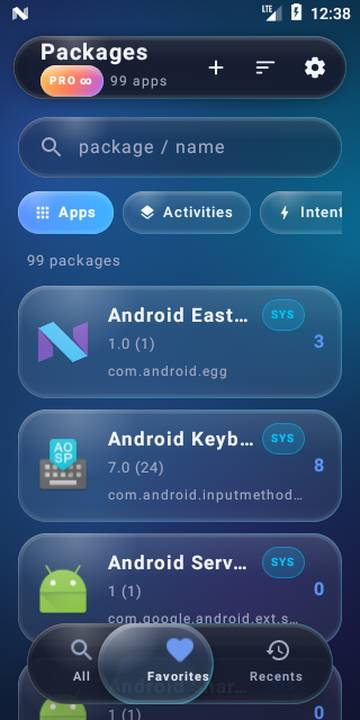 |  |
