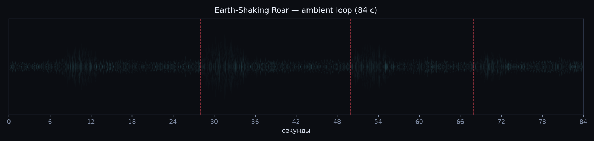

# Earth-Shaking Roar — эмбиент в духе Voices of the Void

Оригинальный процедурно синтезированный звук, вдохновлённый случайным событием
**Earth-Shaking Roar** из *Voices of the Void*: «рёв неизвестного существа сотрясает
местность вокруг игрока». Никакие звуковые файлы из игры не использовались —
всё сгенерировано с нуля (см. `render.py`).



## Файлы

| Файл | Что это | Формат |
|---|---|---|
| `earth-shaking-roar-ambient.ogg` | **Основной луп**, 84 с, 4 рёва (≈7.5 / 28 / 50 / 68 с). OGG/Vorbis — **бесшовный**, без энкодерного хвоста | 44.1 кГц, стерео |
| `earth-shaking-roar-ambient.mp3` | Тот же луп для плееров/соцсетей (192 kbps). Из-за LAME-паддинга длина 84.04 с — для идеального лупа берите OGG | 44.1 кГц, стерео |
| `earth-shaking-roar-oneshot.wav` | **Одиночный рёв**, 10.8 с, готовый SFX для движка/видео | PCM 16-bit, 44.1 кГц, стерео |
| `earth-shaking-roar-oneshot.mp3` | То же, но MP3 192 kbps | 44.1 кГц, стерео |
| `render.py` | Исходный генератор (numpy + scipy + soundfile + lameenc) | Python |

> ⚠️ Звук намеренно громкий и с большим количеством суб-баса (20–60 Гц).
> Начинайте с невысокой громкости. На ноутбучных динамиках инфразвук почти не
> слышен — используйте наушники/сабвуфер, «середина» 200–2000 Гц
> добавлена специально, чтобы рёв читался и на маленьких колонках.

## Как это сделано

**Рёв:** стартовый удар (47 Гц + шумовой щелчок) → резкий питч-даун ≈200 → 35 Гц →
пять «дыхательных толчков» с дребезгом горла на 17 Гц → гармонический рык с
движущимися формантами (3 спектральные полосы) → надрывный визг 430→1680 Гц →
три умирающих всхлипа в хвосте → convolution-реверб с ранними отражениями.
Сверху суб-октава + инфразвук 27 Гц для ощущения «тряски экрана».

**Фон:** диссонирующий дрон E1/F1/B1 с медленным биением, коричневый шум ветра с
порывами, радио-статик и потрескивания, почти-шёпот в полосе 380–1700 Гц,
редкие металлические призвуки, глухие подземные удары-«пульс». Во время рёва фон
приглушается (сайдчейн-даккинг), а весь микс слегка амплитудно модулируется.

**Мастеринг:** ФВЧ 24 Гц, мягкая компрессия 3:1, сатурация `tanh`, пик −1 дБFS,
дизеринг при записи 16-bit. Луп склеен кроссфейдом 6 с, скачок на стыке ~0.008.

## Перегенерация

```bash
pip install numpy scipy soundfile lameenc
python render.py                 # ogg + mp3 луп, wav + mp3 одиночный рёв
python render.py --seed 777      # другой вариант (шум, панорама, призвуки)
python render.py --wav-loop      # + несжатый WAV луп (~15 МБ) для игрового движка
```

Что крутить в `render.py`:

- `LOOP_SECONDS` — длина лупа, `CROSSFADE` — зона склейки.
- `EVENTS` — время, длительность, `f_start`/`f_end` питч-дауна, громкость,
  панорама и уровень визга для каждого из четырёх рёвов.
- В `make_roar()`: `shriek` (визг), `tail` (хвост), количество/амплитуда
  «выдохов» в `env`, веса `dark`/`mid`/`bright` (тембр).
- В `build_bed()`: уровни дрона, ветра, статики и шёпота.

## Использование

Можно свободно использовать в своих видео, модах и играх — это оригинальный
материал, а не рип ассетов игры. При упоминании достаточно ссылки на папку.
