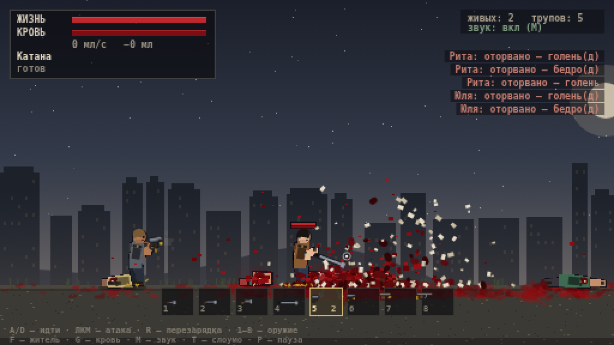

# ПЕСОЧНИЦА КРОВИ — 2D pixel gore sandbox

Пиксельная боевая песочница в духе **WorldBox / People Playground / Carmageddon**:
маленькие человечки, отрывающиеся конечности, честная симуляция крови и
оружие от кухонного ножа до СВД.

Всё нарисовано кодом (canvas, никаких ассетов), звук — процедурный WebAudio.



## Запуск

```bash
cd game
npm start          # http://localhost:5173
```

Либо просто открой `game/index.html` — это чистый ES-модуль без сборки
(но через `file://` браузер может ругаться на модули, поэтому сервер надёжнее).

Тесты:

```bash
npm test           # headless-прогон логики (нужен только node)
node test/render.mjs   # рендер кадров в shots/ (требует @napi-rs/canvas)
```

## Управление

| Клавиша | Действие |
| --- | --- |
| `A` / `D` | идти |
| `ЛКМ` | удар клинком / выстрел (зажать для автоматического) |
| `R` | перезарядка |
| `1`–`8` или колесо | выбор оружия в нижней панели |
| `ПРОБЕЛ` | рывок; если лежишь — встать |
| `Shift` | бег |
| `F` | добавить жителя |
| `G` | стереть кровь с земли |
| `T` | слоу-мо (x1 → x0.35 → x0.12) |
| `M` | звук |
| `P` | пауза |
| `R` (после смерти) | возродиться |

## Оружие

| # | Оружие | Особенности |
| --- | --- | --- |
| 1 | Нож | быстрый, глубокий порез, сильное кровотечение |
| 2 | Мачете | длиннее, отрубает руки/головы |
| 3 | Топор | тяжёлый: ломает кости, отбрасывает, но режет хуже |
| 4 | Катана | самый чистый разрез, длинная дистанция |
| 5 | Пистолет | 12 патронов, одиночный, умеренная отдача |
| 6 | ПП «Вихрь» | автоматический, разброс растёт от стрельбы |
| 7 | Дробовик | 9 дробин, конус, чудовищный урон в упор |
| 8 | СВД | пробивает насквозь, огромный структурный урон |

## Что симулируется

**Анатомия.** У человека 10 «частей» с разной толщиной и уязвимостью:
голова, торс, плечи/предплечья, бёдра/голени. Каждая имеет
- `health` — локальные повреждения;
- `struct` (0…1) — разрушение тканей: выше 0.45 — мясо наружу, выше 0.7 — перелом;
- раны (`wounds`) с положением, размером и скоростью кровотечения;
- артериальное повреждение — фонтан в такт сердцу.

**Кровь.** У человека ~5 литров. Каждая рана даёт кровоток в мл/с,
он падает по мере свёртывания. Ниже 3.4 л начинается геморрагический шок
(постоянная потеря HP), на нуле — смерть. Капли летят по баллистике,
оставляют пятна на земле; под лежачими растёт лужа. Слой декалей
накапливается на отдельном canvas и ограничен по площади, чтобы производительность не падала.

**Отрыв конечностей.** Шанс отрыва зависит от структурного урона,
типа оружия (пуля отрывает хуже, чем клинок), глубины пореза и перелома.
Отрубленная часть превращается в отдельный физический объект: падает,
кувыркается, оставляет кровавый след, из культи продолжает хлестать кровь.
Вместе с частью отваливаются её «дети» (предплечье/голень), из руки выпадает оружие.
Голова при отрыве — мгновенная смерть; попадание в череп может разнести его в кашу.

**Рэгдолл.** Тело — это 16 точек на пружинных связях (веревочная физика).
Тяжёлое попадание, перелом ноги или отрыв конечности роняют человека;
он валяется, корчится, может встать, если ноги целы и он не истёк кровью.

**Баллистика.** Пули — реальные снаряды: скорость 1550–2900 px/s,
гравитация, сопротивление воздуха, шаг интегрирования с подшагами
(без «телепортации» сквозь тела). Дробь — 9 независимых дробин с конусом.
Урон зависит от части тела (голова ×2.4, конечности ×0.4).
Разброс растёт при движении и от темпа стрельбы, отдача реально толкает тело
и задирает ствол. Гильзы вылетают и звенят по асфальту.

**ИИ.** Жители держат дистанцию под своё оружие, целятся с задержкой реакции,
дёргают стволом, перезаряжаются, паникуют и убегают ранеными, а ещё дерутся
друг с другом — в песочнице постоянно кто-то умирает, и вы можете просто смотреть.

## Файлы

```
game/
├── index.html        оболочка и стили
├── server.mjs        статический сервер без зависимостей
├── src/
│   ├── main.js       цикл игры, сцена/фон, HUD, меню
│   ├── player.js     человек: поза, IK, рэгдолл, урон, кровь, отрисовка
│   ├── weapons.js    каталог оружия, баллистика, удары клинком
│   ├── gore.js       частицы крови, гибсы, гильзы, декали, кровь на «камере»
│   ├── audio.js      процедурные выстрелы/крики/разрывы (WebAudio)
│   └── util.js       математика, геометрия, константы экрана
└── test/             headless-прогон и рендер PNG
```
