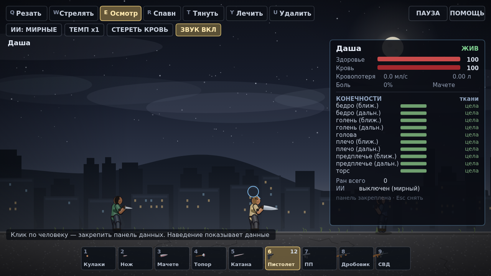
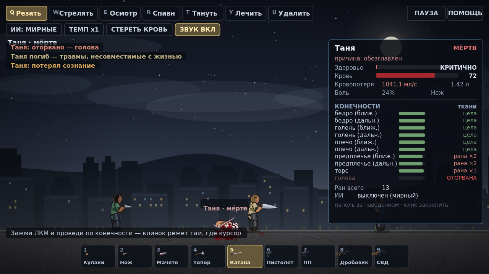

# ПЕСОЧНИЦА — кровавый 2D sandbox

Ты не персонаж — ты режиссёр сцены. Спавнишь людей, режешь им конечности курсором,
стреляешь из-за кадра, тащишь тела мышкой и смотришь подробные данные любого
человека: кровь, раны, переломы, оторванные части, сознание.

Графика — гладкая векторная (canvas 2x, без пиксельных артефактов), интерфейс
на русском, всё считается в реальном времени. Ассетов нет, звук — процедурный WebAudio.




## Запуск

```bash
cd game
npm start        # http://localhost:5173
```

Тесты:

```bash
npm test               # headless: физика, смерть, инструменты
node test/render.mjs   # рендер кадров в shots2/ (нужен @napi-rs/canvas)
```

## Инструменты (верхняя панель)

| Клавиша | Инструмент | Что делает |
| --- | --- | --- |
| `Q` | **Резать** | Зажми ЛКМ и веди по конечности. Клинок режет ровно там, где курсор. Скорость проводки = сила пореза |
| `W` | **Стрелять** | ЛКМ — огонь. Стрелок за кадром: пули влетают из-за края экрана точно в прицел |
| `E` | **Осмотр** | Наведение показывает данные человека справа; клик закрепляет панель (`Esc` снять) |
| `R` | **Спавн** | Клик по земле — новый человек. `Shift`+клик — сразу с оружием, без Shift — случайно |
| `T` | **Тянуть** | Зажми человека и тащи: тело станет рэгдоллом и потянется за курсором |
| `Y` | **Лечить** | Останавливает кровь, залечивает раны, выводит из шока (мёртвых не воскрешает) |
| `U` | **Удалить** | Убирает человека из песочницы |

Дополнительно: `1–8` или колесо — оружие, `Space` — слоумо (x1 → x0.35 → x0.12),
`H` — справка, `P` — пауза, `M` — звук, `Backspace` — убрать трупы, кнопки
`ИИ` (мирные/агрессивные), `ТЕМП`, `СТЕРЕТЬ КРОВЬ`.

## Оружие

| # | Оружие | Особенности |
| --- | --- | --- |
| 1 | Кулаки | тупой урон, ломает кости, почти не режет |
| 2 | Нож | быстрый, глубокий порез, сильно кровит |
| 3 | Мачете | длинный разрез, отрывает конечности за 2–3 проводки |
| 4 | Топор | тяжёлый: ломает, отбрасывает, режет плохо |
| 5 | Катана | самый чистый и длинный разрез |
| 6 | Пистолет | 12 патронов, точный |
| 7 | ПП | автоматический, разброс растёт |
| 8 | Дробовик | 9 дробин, в упор сносит |
| 9 | СВД | пробивает насквозь, чудовищный урон |

## Физика и смерть

**Рэгдолл на PBD.** Тело — 16 точек, соединённых жёсткими связями (позиционная
динамика, 2 подшага × 6 итераций). Скорость выводится из реального перемещения
точек, поэтому нет «пружинного» дрожания: тело падает, катится, цепляется за землю
и засыпает, когда успокаивается. Локти и колени ограничены по углу — не выгибаются назад.

**Импульсы точечные.** Попадание передаёт импульс в точку удара и распределяет его
по neighbouring точкам: пуля дёргает ткань, дробовик в упор отбрасывает, топор валит
с ног. Тело не «пинается» целиком от каждой царапины.

**Смерть адекватная, а не от царапины:**

- пистолет — 4–5 попаданий в корпус, 1–2 в голову;
- СВД и дробовик в упор сносят голову сразу;
- ранение в бедро не убивает мгновенно: человек падает, истекает кровью, теряет сознание;
- артериальное ранение в торс убивает за ~30–40 секунд;
- тяжёлая кровопотеря → геморрагический шок (HP падает тем быстрее, чем меньше крови) → смерть;
- при <16 HP, <1.4 л крови или сильной боли человек теряет сознание и падает;
  если кровь остановить — может прийти в себя;
- после смерти сердце не бьёт: фонтаны прекращаются, остаётся только стекание.

**Кровь.** ~5 литров на человека. Каждая рана даёт свой мл/с, который падает по мере
свёртывания. Артерии хлещут в такт сердцу. Капли летят по баллистике и оставляют
пятна; под лежачими растут лужи; слой декалей ограничен по площади.

**Расчленение.** Сначала режется кожа и мясо (структурный урон), только потом
конечность отрывается: каждый порез добавляет шанс. Пули отрывают редко, клинки — часто.
Отрубленная часть падает отдельным физическим объектом, из культи хлещет кровь,
из severed-руки выпадает оружие, голова = мгновенная смерть.

**Баллистика.** Пули — снаряды со скоростью 1550–2900 px/s, гравитацией,
сопротивлением воздуха и подшагами интегрирования (не проходят сквозь тела).
Дробовик — 9 независимых дробин. Урон зависит от части тела (голова ×2.4, конечности ×0.4).

## Панель данных человека

Справа: имя, статус (жив / без сознания / мёртв + причина), здоровье, объём крови,
текущая кровопотеря, боль, оружие, таблица всех 10 частей тела с полоской целостности
и статусом (`цела` / `рана ×N` / `перелом` / `ОТОРВАНА`), число ран и текущая цель ИИ.

## Файлы

```
game/
├── index.html        оболочка
├── server.mjs        статический сервер без зависимостей
├── src/
│   ├── main.js       песочница: инструменты, HUD, инспектор, сцена
│   ├── player.js     человек: тело, рэгдолл, раны, кровь, смерть, отрисовка
│   ├── weapons.js    оружие, векторные спрайты, баллистика, удары клинком
│   ├── gore.js       кровь, куски плоти, гильзы, декали
│   ├── audio.js      процедурные звуки (WebAudio)
│   └── util.js       математика, геометрия, константы
└── test/             headless-тесты и рендер PNG
```
