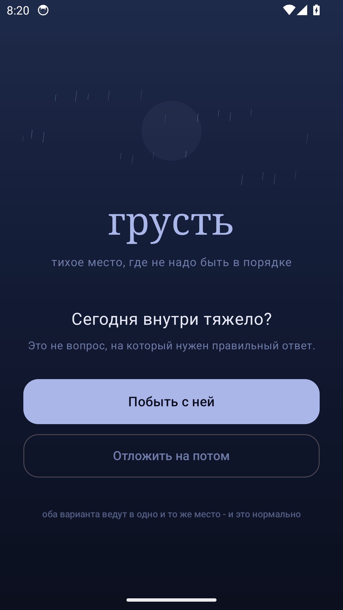
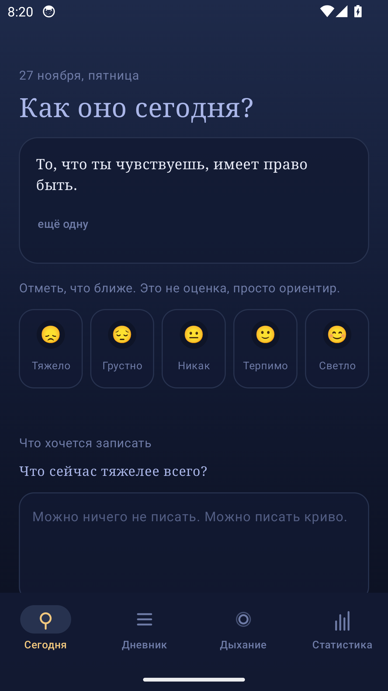
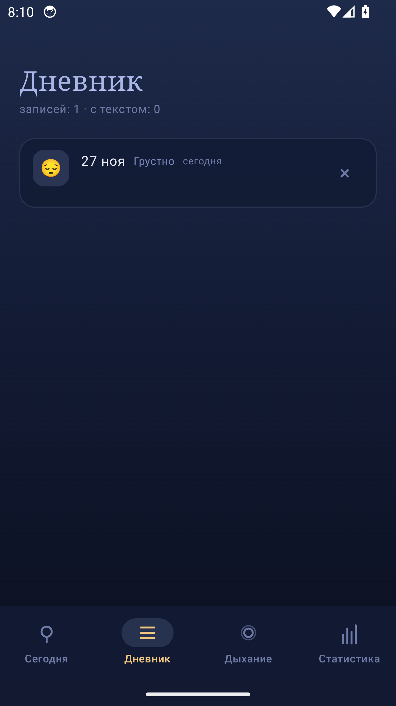
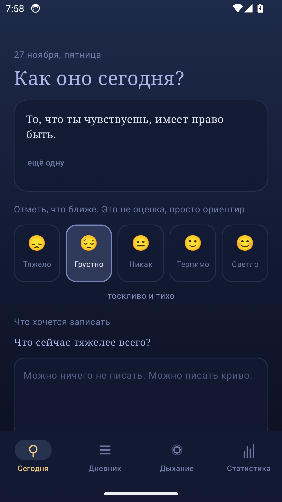
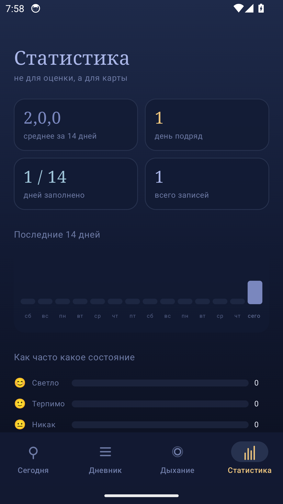
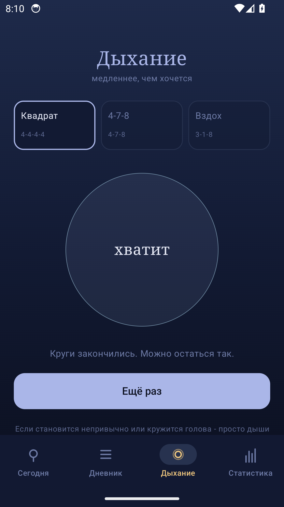

# Грусть

Android-приложение о грусти. Не про то, как перестать грустить, а про то, чтобы побыть с этим
рядом: дневник настроения, медленное дыхание и карта последних двух недель.

Офлайн и без разрешений. Дневник лежит в `SharedPreferences` на телефоне и никуда не уходит.

## Скачать APK

Свежая сборка: **[Grust-1.0.0.apk](https://github.com/Korimuspast1/pr/releases/download/grust-apk/Grust-1.0.0.apk)**
(рядом — `SHA256SUMS.txt`, проверить: `sha256sum -c SHA256SUMS.txt`).

APK подписан debug-ключом: он ставится вручную (нужно разрешить установку из неизвестных
источников), но не годится для Google Play. Минимальная версия — Android 8.0 (API 26).

## Что внутри

| Экран | Что делает |
| --- | --- |
| Вход | один вопрос и одна кнопка. «Побыть с ней» и «Отложить» ведут в одно место — приложение не требует ответа |
| Сегодня | фраза дня, отметка настроения по пяти мягким ступеням (от «тяжело» до «светло»), необязательная заметка |
| Дневник | все записи, новые сверху; удаление спрашивает подтверждение |
| Дыхание | «Квадрат» 4-4-4-4, «4-7-8» и «Вздох» 3-1-8; круг дышит вместе с тобой, есть счётчик и пауза |
| Статистика | серия дней подряд, среднее за 14 дней, распределение состояний, короткий вывод |

Фразы поддержки и вопросы для заметки выбираются по дате, а не случайно: одна и та же фраза
держится весь день, и это повод вернуться на следующий.

## Скриншоты

Их делает эмулятор в CI (`screenshots/`), а не художник: это настоящие кадры запущенного
приложения, снятые на API 34 во время прогона из `tools/ci-smoke.sh`.

| Вход | Сегодня | Дневник |
| --- | --- | --- |
|  |  |  |

| Настроение | Статистика | Дыхание |
| --- | --- | --- |
|  |  |  |

## Сборка

Локально нужен JDK 17 и Android SDK 37:

```bash
cd grust-android
./gradlew testReleaseUnitTest assembleRelease
# APK: app/build/outputs/apk/release/app-release.apk
```

В репозитории APK собирает GitHub Actions — `.github/workflows/grust-android.yml`, потому что на
машине, где писался код, нет ни JDK, ни Android SDK. Workflow делает две вещи:

* `build` — юнит-тесты, `assembleRelease`, публикация APK и суммы в rolling-release `grust-apk`
  (артефакт Actions требует авторизации для скачивания, ассет релиза — нет);
* `smoke` — ставит debug-сборку на эмулятор API 34, проходит по всем экранам через uiautomator
  (с прокруткой, если кнопка ниже сгиба), падает при `FATAL EXCEPTION` в logcat и коммитит
  скриншоты обратно в ветку.

## Структура

```
grust-android/
  app/src/main/java/com/zalchik/grust/
    data/      Mood, MoodEntry, MoodStore, EntryCodec, Stats, Words, Practices
    ui/        MainActivity, App, TodayScreen, DiaryScreen, BreatheScreen, StatsScreen
    ui/theme/  палитра и тема
  app/src/test/  StatsTest, EntryCodecTest, RussianTest — 22 теста, JVM, без эмулятора
  tools/         ci-android-sdk.sh, ci-gradle.sh, ci-smoke.sh
```

`data/Stats.kt`, `data/EntryCodec.kt` и `data/Russian.kt` не знают про Android — поэтому их можно
проверять обычными JVM-тестами, включая «вчера заполнено, сегодня ещё нет — серия не рвётся»,
«битый JSON стоит строк, а не всего дневника» и «2,0 не превращается в 2,0,0» (этот баг был в
первой сборке и виден на её скриншоте).

## Если тяжело не по-приложенчески

Приложение не заменяет помощь. Если тяжесть не отпускает неделями, стоит сказать о ней живому
человеку — близкому или специалисту.
