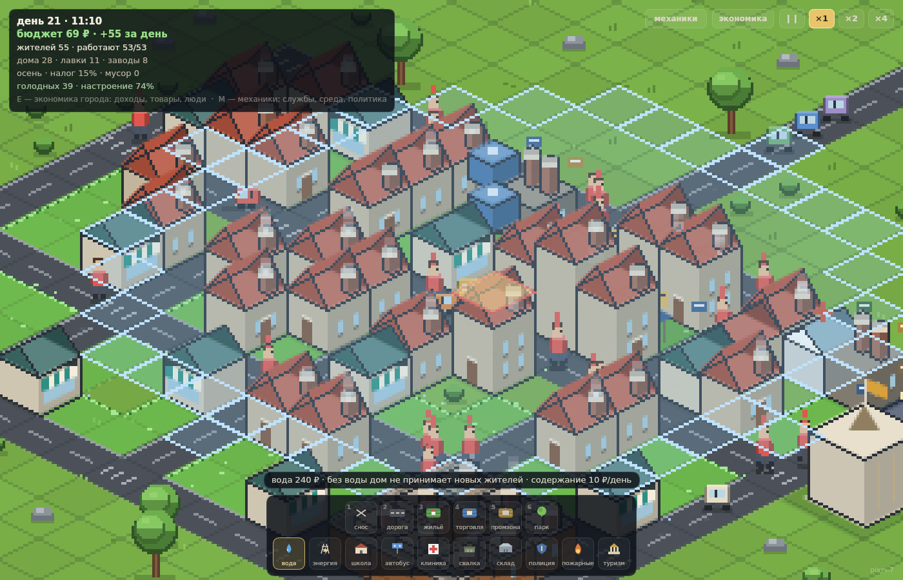
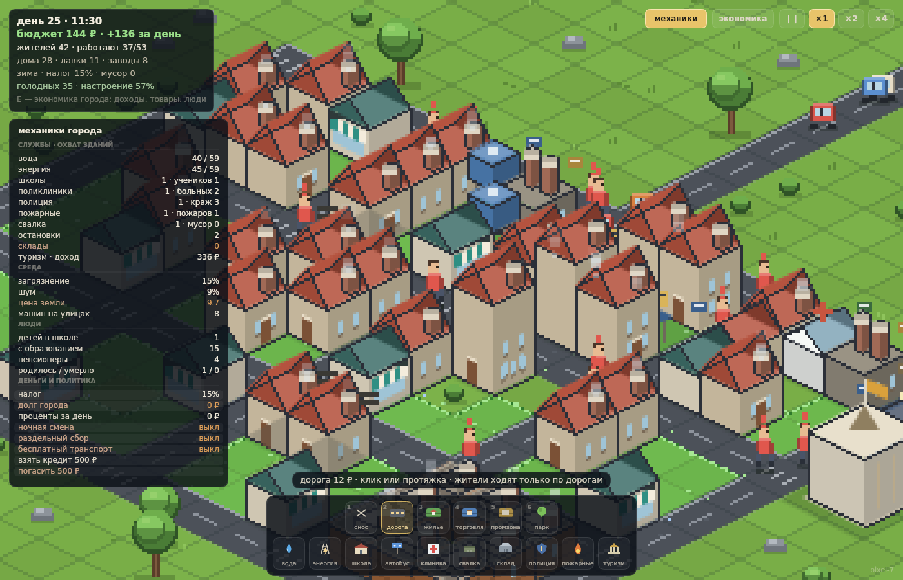
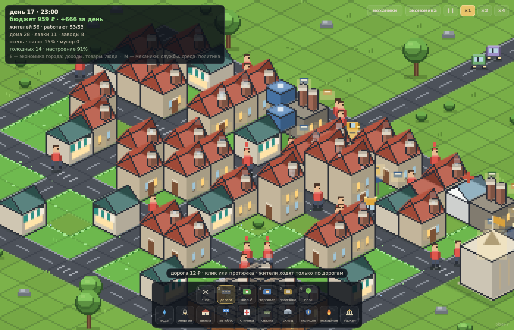

# Пиксельный город · строительство и зоны

Город в **пиксельной изометрии**, который вы строите сами: пустая карта, дороги,
зоны — и дальше город растёт сам. Дома появляются на жилых зонах, лавки на
торговых, заводы в промзоне, в них приезжают жители и выходят на работу.
Деньги по-прежнему не берутся из воздуха.

**Главное правило:** в город можно попасть только по дороге, которая выходит на
край карты. Нет такой дороги — никто не приедет, материалы не привезут, ничего
не построится.

**Интерфейс** нарисован отдельно от карты: текст остаётся чётким при любом
зуме, а панели не увеличиваются вместе с городом.

**Куда уходят деньги** видно сразу: в строке бюджета есть изменение за день, при
каждой стройке всплывает подсказка «стройка: дом · −100 ₽ из бюджета», а по `E`
открывается сводка города — доходы и расходы, оборот, товары и люди.

**Механик больше тридцати**, и все они работают в симуляции, а не только
нарисованы: вода, энергия, школы, поликлиники, полиция, пожарные, мусор,
склады, транспорт, туризм, мосты, сезоны, возраст, образование, здоровье,
кредит, налоги, три политики и вехи роста. Панель `M` — «механики города» —
показывает их живое состояние и позволяет переключать налог, кредит и политики
кликом.


## Как играть

```bash
cd isocity
node serve.mjs 8080      # http://localhost:8080
```

`serve.mjs` отдаёт файлы с `Cache-Control: no-store` и версионирует модули,
поэтому после обновления кода достаточно обычного перезагруза. Если запускаешь
через `python3 -m http.server`, браузер может держать старый JS в кэше —
жми Ctrl+Shift+R. Текущая сборка написана в правом нижнем углу (`pixel-7`);
если там пусто — открылся старый кэш.

Статика на ES-модулях, сборка не нужна. Из файла (`file://`) не откроется —
браузер не грузит модули с диска.

| Что | Как |
| --- | --- |
| выбрать инструмент | панель снизу или клавиши `1…6` |
| строить | ЛКМ, можно вести мышкой — дорога/зона тянется линией |
| сносить | ПКМ (или инструмент «снос») |
| камера | тащить средней кнопкой / `WASD` (любая раскладка и Caps Lock) / стрелки |
| экономика города | `E` или кнопка «экономика» справа сверху |
| механики города | `M` или кнопка «механики» справа сверху |
| масштаб | колесо, щипок двумя пальцами (пиксель всегда целый) |
| пауза, скорость | `P`, кнопки справа сверху, `+`/`-` |
| спрятать интерфейс | `Tab` |

Инструменты: первый ряд — **снос**, **дорога** (12₽), **жильё**, **торговля**,
**промзона**, **парк** (60₽); второй ряд — службы города: **вода**, **энергия**,
**школа**, **автобус**, **клиника**, **свалка**, **склад**, **полиция**,
**пожарные**, **туризм** (с замком, пока не открыты). Клавиши `1…6` — первый ряд,
службы выбираются мышью: их слишком много для горячих клавиш.

Выбранная служба сразу показывает своё покрытие: подсвеченный круг — дома и лавки,
до которых достанет вода, энергия или поликлиника. Постройка на занятом месте
подсвечивается красным.





## Как растёт город

- **Въезд с края карты.** Жители, машины и стройматериалы попадают в город
  только по дороге, доходящей до границы карты. Пока такой дороги нет, участки
  не застраиваются, а жители не приезжают; улицы без выезда помечены на
  асфальте жёлтой меткой. Отрежьте въезд — рост остановится.
- Дорога — основа: пешеходы ходят **только по дорогам** (поиск пути по графу
  дорог), поэтому сквозь стены никто не проходит. Дом без дороги рядом не
  появится, а жители двух разных дорожных сетей не смогут друг к другу попасть.
- **Жилая зона**: дома вырастают, когда в городе больше рабочих мест, чем
  свободных кроватей. Дом даёт 2 места.
- **Торговля**: лавки появляются, когда есть безработные (нужен ещё один
  работодатель) или на одного жителя приходится меньше одной лавки.
- **Промзона**: заводы дают рабочие места и товар, который лавки закупают
  грузовиками. Завод растёт, когда полки пустеют.
- **Парк**: скамейки, деревья, иногда фонтан; поднимает настроение.
- **Зоны** закрашены ярко (жильё — зелёным, торговля — синим, промзона —
  жёлтым) с рамкой и крапинками, чтобы размеченная земля была видна сразу.
- Люди **приезжают** по дороге с края карты в свободные дома и **уезжают**, если
  долго голодают и не могут платить аренду. В полдень половина работников
  выходит за хлебом, так что улицы живые весь день; между домами, лавками и
  заводами ездят машины и грузовики (только по дорогам). Большая часть машин
  въезжает в город с края карты, останавливается у здания и уезжает обратно —
  это видно на дороге к въезду.
- Первый дом в пустом городе строит наёмная бригада извне (её оплата уходит из
  города), дальше строят сами жители, а бригада подключается, только если
  горожанам некогда.

## Механики города (30+)

Панель `M` показывает их вживую: охват служб (сколько зданий достаёт вода и
энергия), среду (загрязнение, шум, цену земли), людей (школьники, образование,
пенсионеры, рождения и смерти) и деньги с политикой. Строки «налог», «кредит» и
политики — кнопки: клик меняет город.

| № | Механика | Что она делает в симуляции | Где видно |
| --- | --- | --- | --- |
| 1 | Вода | без покрытия башни дом не строят и не заселяют; сами службы без воды хиреют | панель `M`, тост, подсказка |
| 2 | Энергия | лавка без энергии теряет половину покупателей, завод без энергии стоит | сводка (оборот), панель `M` |
| 3 | Школы | дети учатся с 8 до 13, образование даёт +25 % выработки | панель `M`, сводка |
| 4 | Образование | взрослый с образованием зарабатывает больше | зарплаты в сводке |
| 5 | Поликлиники | больные лечатся, без клиники болеют дольше и уезжают | панель `M` |
| 6 | Здоровье | болезнь укладывает жителя дома, работа стоит | панель `M`, арт |
| 7 | Свалки | мусор копится, свалка его вывозит; горы мусора портят настроение | панель `M`, мусор на карте |
| 8 | Склады | склад снабжает лавки по 6.5 ₽; без склада лавка импортирует по 9 ₽ | сводка «товары» |
| 9 | Логистика | грузовики возят товар со склада и завода в лавки | машины на дорогах |
| 10 | Полиция | без покрытия растут кражи, касса жителей тает | панель `M`, сводка |
| 11 | Пожарные | пожары случаются редко; с частью рядом — тушат, без неё здание теряется | тост, огонь на карте |
| 12 | Пожары | горящее здание теряет деньги и жителей, пока не потушат | арт огня |
| 13 | Туризм | достопримечательность приносит деньги за день | панель `M`, сводка |
| 14 | Мосты | дорогу можно вести через реку: мост дороже (60 ₽), снос возвращает воду | карта, бюджет |
| 15 | Река и озеро | вода режет карту: без моста район остаётся отрезанным | карта |
| 16 | Сезоны | весна/лето/осень/зима по 8 дней, зимой топить дороже, настроение ниже | строка статуса, панель |
| 17 | Возраст | жители взрослеют, стареют и умирают; дети и пенсионеры не работают | панель `M` |
| 18 | Пенсии | пенсионер получает 22 ₽/день из бюджета | сводка |
| 19 | Рождения | в семьях с крышей рождаются дети (без «подарка» наличных) | панель `M`, тост |
| 20 | Налог на недвижимость | 5–35 %, доля от цены земли: больше денег, меньше настроения | панель `M`, сводка |
| 21 | Содержание служб | каждая служба стоит upkeep каждый день | сводка, панель `M` |
| 22 | Кредит | взять и погасить по 500 ₽, проценты 0.4 % в день | панель `M`, сводка |
| 23 | Ночная смена | заводы работают круглосуточно (+15 %), но шумят | панель `M` |
| 24 | Раздельный сбор | мусора вдвое меньше, 25 ₽/день | панель `M` |
| 25 | Бесплатный транспорт | настроение вверх, 20 ₽/день | панель `M` |
| 26 | Настроение | складывается из аренды, налогов, служб, мусора, шума, сезона | статус, сводка |
| 27 | Миграция | приезжают, если есть работа и свободная кровать; уезжают от плохой жизни | тост, панель |
| 28 | Вехи роста | 4, 8, 12, 18, 20, 22, 26, 30, 40, 60 жителей: грант и новая служба | тост, панель `M` |
| 29 | Безработица | лишние руки дешевеют, город тянет новые лавки и заводы | статус, сводка |
| 30 | Апартаменты | дом с водой, энергией и деньгами достраивается до 3 уровней | арт домов |
| 31 | Заброшенность | дом без воды и энергии пустеет и зарастает | арт, тост |
| 32 | Цена земли | зависит от парков, служб, шума и мусора; от неё налог | панель `M` |
| 33 | Загрязнение | заводы пачкают соседние кварталы, настроение падает | панель `M` |
| 34 | Шум | заводы и круглосуточная смена мешают жить | панель `M` |
| 35 | Трафик | машины въезжают с края, стоят у здания и уезжают; автобус уменьшает поток | карта |

Все числа симуляции проходят через один аудит: `sim.audit()` остаётся `0.000`
и через 45 дней, то есть ни одна служба, пенсия, грант или политика не печатает
деньги.

## Сводка города (`E`)

Правая панель показывает:

- **деньги города** — бюджет, изменение за день, сколько потрачено;
- **оборот** — аренда, налоги, выручка лавок, закупка товара у заводов,
  экспорт, зарплаты, стройка (сегодня и за всю игру);
- **товары** — произведено на заводах, куплено жителями, вывезено, завезено,
  лежит на полках, число лавок и заводов;
- **люди** — жителей, работают, безработных, голодных, средняя касса.

Панель сама подстраивает плотность под высоту окна, чтобы не налезать на
панель инструментов.

## Экономика: деньги не из воздуха

```
жители --аренда/налог--> бюджет города --зарплата---> стройка, дороги, парки
предприятия --зарплата--> жители --покупки--> лавки --> заводы (товар)
заводы --экспорт за границу города--> внешние деньги (учтены отдельно)
```

- Зарплата платится **из кассы предприятия**; если денег не хватает — пропорционально
  остатку, долг копится.
- Стройка домов и лавок оплачивается из бюджета города: деньги уходят рабочим
  (кто остался без работы — те и строят дороги и парки), а не исчезают.
- Цены лавок и заводов подстраиваются под себестоимость и кассу.
- Три вида внешних денег, все учтены отдельно: сбережения приезжих, деньги
  уехавших и выручка от экспорта (излишки заводов), плюс оплата наёмной бригады
  и импорт товара для новой лавки — как расход наружу.
- Проверка `sim.audit()` сверяет всю внутреннюю массу денег с начальной и с
  внешними потоками. В тестах она даёт ровно `0`.



## Тесты

```bash
cd isocity/tools && npm install   # только @napi-rs/canvas для картинок
cd ..

node tools/live-test.mjs 40    # 40 дней города: рост, безработица, аудит денег
node tools/smoke.mjs           # настоящий игровой цикл в фейковом браузере:
                               # дорога до края, зоны, рост, снос, зум, HUD
node tools/app-shot.mjs app.png 1280 800 300 14 560   # кадр из настоящего цикла
node tools/preview.mjs 1400 900 docs/day.png 560 2 20 18 14  # скриншот без браузера
```

`live-test` печатает рост по дням и заканчивается `money audit 0.000000000`.
`smoke` проверяет все правила игры: пустая карта без жителей, тупиковая улица
ничего не строит, дорога до края включает стройку и приезд, все пешеходы и
машины только на дорогах, HUD не меняет размер при зуме, снос въезда
останавливает приезжих, мост через реку строится и сносится, водонапорная башня
включает стройку, службы открываются по населению, панель механик рисует живые
строки, налог/политика/кредит переключаются кликом, деньги не печатаются.

`tools/demo-town.mjs` — общий «план игрока» (дорога от края, сетка улиц, зоны),
его используют тесты и скриншоты.

## Файлы

| Файл | Что внутри |
| --- | --- |
| `index.html` | только canvas, никакой вёрстки |
| `src/main.js` | ввод: мышь, клавиши, рисование протяжкой, игровой цикл |
| `src/sim.js` | симуляция: время, зоны, рост, жители, работа, бюджет |
| `src/world.js` | карта, река и мосты, дорожная сеть, компоненты связности, поиск пути |
| `src/mechanics.js` | службы, вехи, политики, сезоны, покрытие/загрязнение/шум/цена земли |
| `src/render.js` | пиксельный рендер города + отдельный чёткий слой HUD, камера |
| `src/art.js` | пиксель-арт: дома, лавки, заводы, ратуша, люди, деревья, лавки |
| `src/iso.js` | изометрия 32×16 и примитивы (диамант, коробка, крыша) |
| `tools/` | headless-тесты и рендер скриншотов |

## Что можно добавить дальше

- Собственность игрока: сейчас у бизнеса только касса, можно добавить долю
  города и дивиденды.
- Сохранение города в JSON: вся карта — типизированный массив в `World`.
- Метро и несколько выездов с карты (сейчас въезд — любая дорога на границе).
- Второй город за рекой как отдельный район со своим бюджетом.
