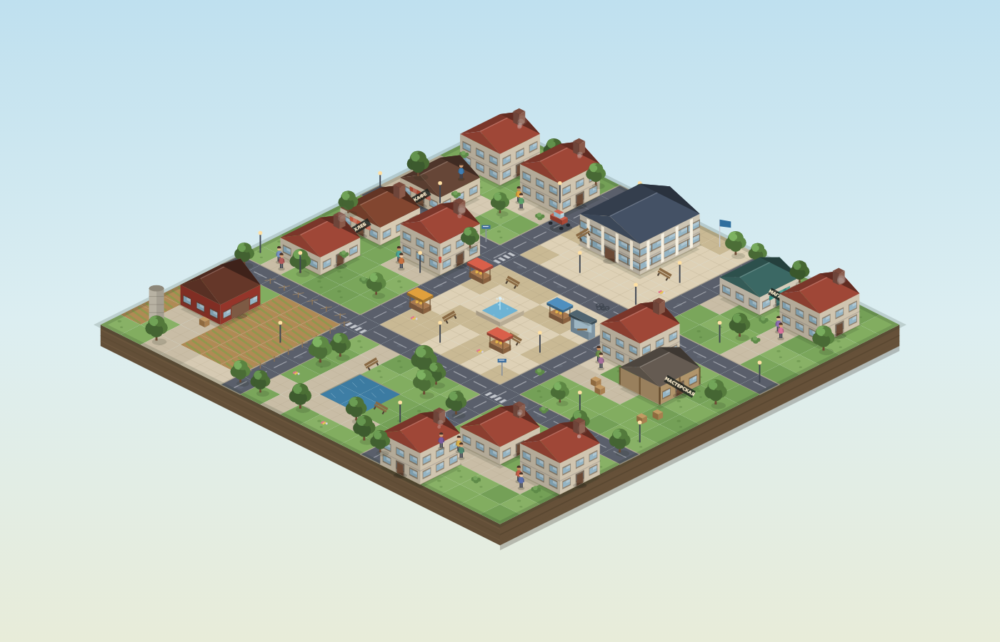
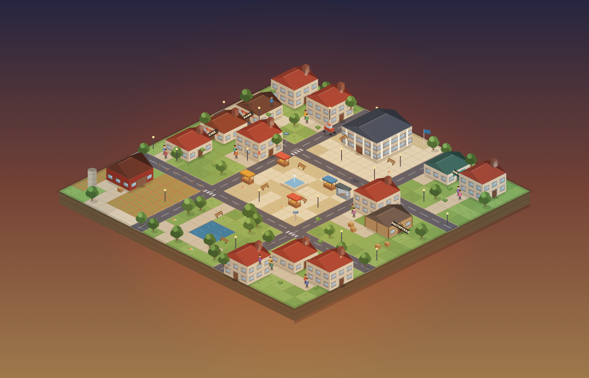
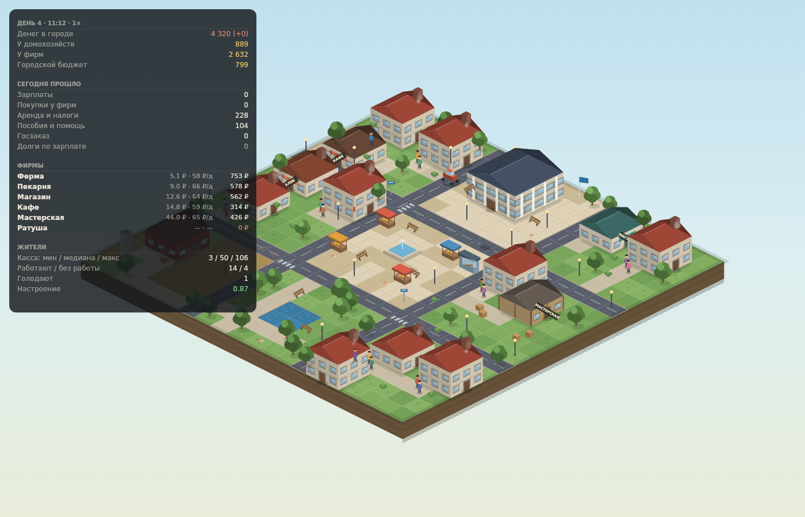

# Изометрия · тестовый город

Тестовый город-диорама в изометрии для будущей игры про градостроительство.
Без GUI: никаких панелей, кнопок и счётчиков на экране — только город, время
суток и живущие своей жизнью люди. Вся симуляция работает в `window.city`,
если что-то нужно посмотреть руками.

Главное правило экономики: **деньги не берутся из воздуха**. Каждый рубль
в городе кому-то принадлежит, и он только переходит от одного агента к другому.
Поэтому и зарплата реальна: её платят из выручки бизнеса, а не «печатают».



## Что происходит на экране

- **20×20 клеток**: четыре улицы, центральная площадь с фонтаном и прилавками,
  площадь перед ратушей, парк с прудом, фермерское поле с сараем и силосом.
- **18 жителей** в 9 домах. Утром они идут на работу (у каждого одно место),
  в 8:00 начинается смена, в 16:00 — конец: кто-то идёт в магазин за хлебом,
  кто-то в кафе, кто-то присматривает мебель в мастерской. К 22:30 все дома.
- **6 предприятий**: ферма, пекарня, магазин, кафе, мастерская и ратуша
  (городская служба).
- **Деньги видны**: над людьми и зданиями всплывают монетки с суммой — это
  настоящие транзакции из симуляции (зарплата, покупка, налог, пособие),
  а не декоративные эффекты.
- Днём и вечером меняется свет, ночью горят окна и фонари, из труб идёт дым.



## Как запустить

```bash
cd isocity
python3 -m http.server 8080
# открыть http://localhost:8080
```

Это обычная статика на ES-модулях, сборка не нужна. Подойдёт любой статический
сервер (`npx serve`, `php -S`, nginx). Просто открыть `index.html` из файла
не получится: браузер не загрузит модули по `file://`.

Управление:

| Действие | Что делает |
| --- | --- |
| перетаскивание | сдвиг камеры |
| колесо / щипок | масштаб |
| `F` | вернуть весь город в кадр |
| `H` | показать/скрыть экономику (по умолчанию скрыта) |
| `пробел` | пауза |
| `1` `2` `3` `4` | скорость 1×, 2×, 4×, 8× |

## Экономика

Каждый агент начинает с фиксированной суммой, и дальше деньги только
переходят между балансами:

```
предприятия --зарплата--> домохозяйства --покупки--> предприятия
домохозяйства --аренда--> городской бюджет --зарплата/пособия/госзаказ--> все
```

Подробности, которые и делают модель «честной»:

- **Зарплата — из выручки.** Каждый час смены предприятие платит из своей кассы.
  Если денег не хватает, оно платит всем пропорционально тому, что есть,
  а остаток записывается в долг (`arrears`) и гасится, как только появляются
  деньги. Первым в списке никто не получает больше.
- **Цены — из себестоимости.** Цена = (фонд оплаты труда + закупка сырья) /
  запланированный объём продаж × наценка. Наценка зависит от кассы: у бедного
  предприятия она выше, у богатого ниже.
- **Склад — из спроса.** Заказ сырья и товара считается по сглаженным продажам,
  но не ниже проектного объёма: один плохой день не должен обрушивать поставки.
- **Цепочка поставок.** Ферма → мука → пекарня → хлеб → магазин/кафе.
  Закупка — это платёж между двумя предприятиями, по улицам за ним едет грузовик.
- **Город.** Аренда, налог на крупные сбережения и налог на «простаивающую»
  кассу предприятий наполняют бюджет. Бюджет платит зарплату ратуше, пособия
  безработным, субсидирует хлеб для тех, у кого нет денег, и закупает мебель
  в мастерской (госзаказ). Если предприятие встало (нет ни денег, ни товара),
  город может выдать ему беспроцентный займ — он возвращается из выручки.
- **Никакой эмиссии.** `sim.auditMoney()` сверяет сумму всех балансов с
  начальной. Если появилась хоть копейка — в консоли будет предупреждение,
  а тест упадёт.

Вот так выглядит скрытая панель (`H`), по ней удобно проверять, что деньги
не появляются и не исчезают:



## Проверка без браузера

```bash
cd isocity/tools
npm install          # один пакет: @napi-rs/canvas (для картинок)
cd ..

node tools/economy-test.mjs 30     # 30 дней симуляции, последняя строка — drift
node tools/smoke.mjs               # прогон настоящего игрового цикла на фейковом браузере
node tools/render-preview.mjs docs # перерисовать картинки в docs/
```

`economy-test.mjs` печатает сводку по дням и обязан закончиться строкой
`drift 0.000000000`. Пример за 30 дней:

```
день 30 · всего 4320 ₽ · касса жителей 2/22/500 · бюджет 206 · голод 0.15 · настроение 0.75
последний день, обороты: wages=674 cityWages=130 unpaid=0 purchases=617 ...
drift -0.000000000
```

## Файлы

| Файл | Что внутри |
| --- | --- |
| `index.html` | точка входа, только canvas |
| `src/main.js` | игровой цикл, камера, клавиши |
| `src/economy.js` | симуляция: время, жители, предприятия, деньги |
| `src/world.js` | карта города: клетки, здания, дорожки, декор |
| `src/render.js` | изометрический рендер: земля, дома, люди, свет, деньги |
| `src/iso.js` | проекция и примитивы (диамант клетки, стены, коробка) |
| `src/overlay.js` | опциональная панель экономики |
| `src/util.js` | математика, цвет, форматирование |
| `tools/` | headless-тесты и offline-рендер картинок |

## Что дальше (задел под игру)

- Постановка зданий игроком: сетка уже есть, `world.blocked` и `isWalkable`
  определяют маршруты, так что новый дом достаточно вписать в карту.
- Рынок труда: сейчас места распределяются при старте; логично сделать
  поиск работы с безработицей, переездами и вакансиями.
- Собственность и стройка: капитал предприятий уже отдельный, можно добавить
  игрока как владельца, дивиденды и кредиты.
- Сохранение состояния: вся симуляция — чистые данные в `Sim`, сериализуется
  без DOM.
