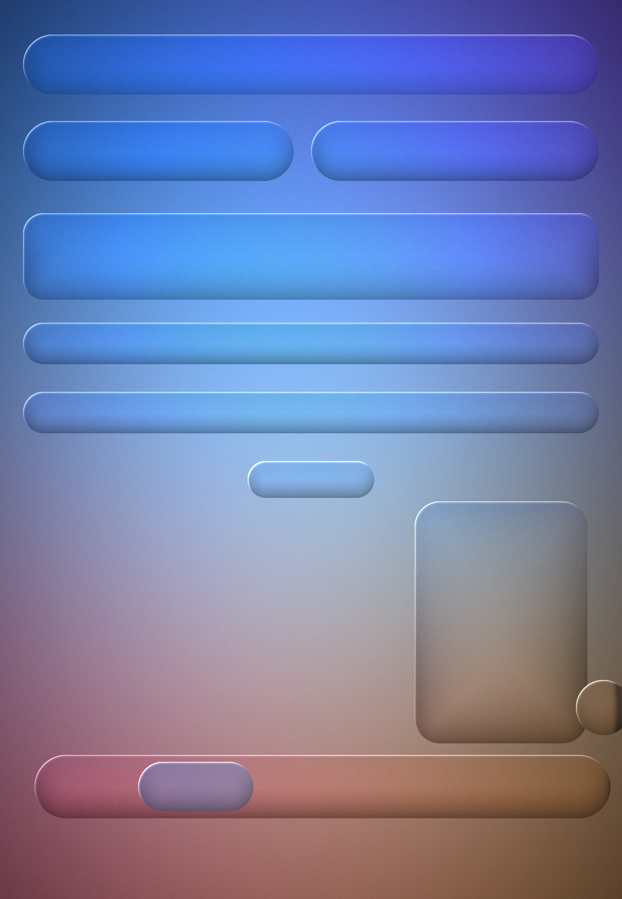

# Liquid Glass Lab

Android-приложение-лаборатория для материала **Liquid Glass** (iOS 26): щупать,
настраивать вживую и повторять 1:1. Плюс документация — как это выглядит, из чего
состоит и как собрать то же самое на Android.

```
┌──────────────────────────────────────┐
│  10:24            Liquid Glass   ⟳ + │  ← тулбар-капсула
│                                      │
│   [ Продолжить ▶ ]   [ Меню ≡ ]      │  ← кнопки-капсулы
│   ──────────────────────────────     │
│   Прозрачность      40 %             │  ← стеклянный слайдер
│   [●──────]                          │
│   ● Переключатель                   │  ← стеклянный тумблер
│                                      │
│   ▁▁▁▁▁▁▁▁▁▁▁▁▁▁▁▁▁▁▁▁▁▁▁▁▁▁▁▁       │  ← контент под стеклом
│   [● Главная][Поиск][Медиа][Профиль] │  ← таб-бар-капсула
│                            [ ⌕ ]     │  ← отдельная круглая кнопка
└──────────────────────────────────────┘
```

## Что внутри

| | |
|---|---|
| **Движок** | `app/src/main/java/.../GlassRender.java` — `RenderNode` + `RenderEffect` + `RuntimeShader` |
| **Шейдер** | `shader/liquid_glass.sksl` — AGSL/SkSL, один файл для приложения и оффлайн-рендера |
| **Компоненты** | кнопка, круглая кнопка, тулбар, таб-бар, слайдер, тумблер, меню, панель |
| **Лаборатория** | 7 сцен, 6 пресетов, 10 параметров вживую, Regular/Clear, доступность |
| **Документация** | [`docs/REFERENCES.md`](docs/REFERENCES.md) · [`docs/HOW-TO-REPLICATE.md`](docs/HOW-TO-REPLICATE.md) · [`docs/SPEC.md`](docs/SPEC.md) |
| **Проверка** | `tools/verify_shader.py` (компиляция шейдера), `tools/skialab.py` (эталонный рендер) |

## Сборка

### Вариант 1 — без Gradle (то, чем собран APK в репозитории)

```bash
python3 tools/build_apk.py --out build/liquidglass-lab.apk
```

Скрипту нужны JDK 17+, `aapt2`, `android.jar`, `d8`/`r8.jar` и `apksigner.jar`
(из `$ANDROID_HOME` или из переменных `AAPT2`, `ANDROID_JAR`, `R8_JAR`,
`APKSIGNER_JAR`). Он делает ровно то же, что Gradle: `aapt2 compile/link` →
`javac` → `d8` → zip → `apksigner`.

### Вариант 2 — Gradle

```bash
cd liquidglass
./gradlew assembleDebug      # или assembleRelease
```

Проект без сторонних зависимостей (нет даже AndroidX), поэтому после первого
скачивания AGP собирается офлайн.

Требования: **Android 13 (API 33)** и новее — нужен `android.graphics.RuntimeShader`.
На API 31–32 приложение запускается, но показывает матовое стекло без линзы.

## Как это работает (кратко)

1. Сцена (обои + контент) записывается в `RenderNode` — один раз на кадр.
2. Тот же узел проходит `RenderEffect(blur)` + `ColorMatrix(saturation)` — это
   «что видно сквозь стекло».
3. Каждый элемент — свой `RenderNode`: сдвинутая копия backdrop'а + `RuntimeShader`,
   который смещает сэмпл вдоль нормали к силуэту (линза), добавляет дисперсию,
   блик по кромке, внутреннюю тень и зерно.
4. Всё считается в premultiplied alpha, AA — по SDF.

Подробно, с формулами и числами: [`docs/HOW-TO-REPLICATE.md`](docs/HOW-TO-REPLICATE.md).

## Эталонные изображения

`docs/img/*.png` сгенерированы `tools/skialab.py` — тем же шейдером, что и в APK,
но отрендеренным на CPU. Их удобно сравнивать с реальным экраном телефона.



## Структура

```
liquidglass/
├── app/src/main/java/dev/arena/liquidglasslab/
│   ├── GlassRender.java        # backdrop + шейдер + силуэты
│   ├── Shaders.java            # сгенерированная копия шейдера (tools/sync_shader.py)
│   ├── GlassParams.java        # все параметры материала
│   ├── GlassPreset.java        # пресеты
│   ├── GlassSurfaceView.java   # базовый вью стекла (RenderNode, нажатие)
│   ├── Glass{Button,Toolbar,TabBar,Slider,Toggle,PopupMenu,MenuItem,SheetControl}.java
│   ├── LabView.java            # лаборатория: сцены, вкладки, тюнинг
│   ├── Scene.java              # 7 процедурных фонов
│   ├── MainActivity.java, DocActivity.java
├── shader/liquid_glass.sksl    # источник истины для оптики
├── tools/                      # сборка, синхронизация и проверка шейдера, оффлайн-рендер
├── docs/                       # референсы, как повторить, ТЗ
└── shader + app/build.gradle.kts, settings.gradle.kts
```

## Лицензии и атрибуция

Код в этом каталоге — оригинальный (Apache-2.0, как и остальной репозиторий).
Идеи и числовые ориентиры сверены с открытыми разборами и портами
(WWDC25-219, HIG, Kyant0/AndroidLiquidGlass, kube.io и др.) — ссылки в
[`docs/REFERENCES.md`](docs/REFERENCES.md). Apple, iOS, Liquid Glass — товарные знаки
Apple Inc.; проект не аффилирован с Apple и повторяет только публично описанное
поведение материала.
