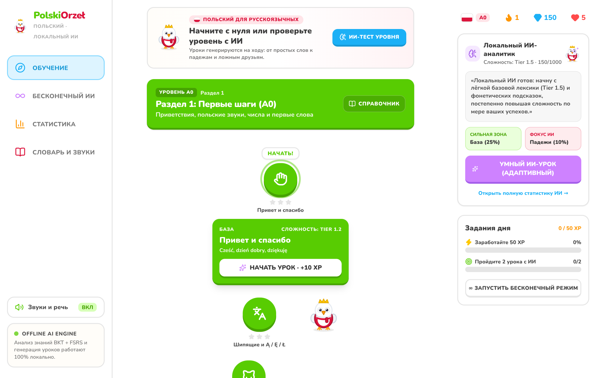
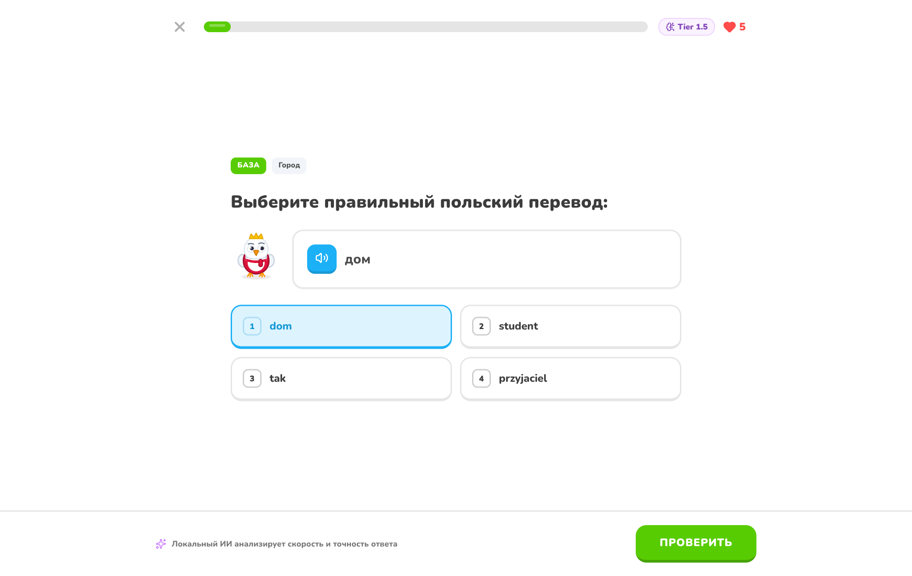
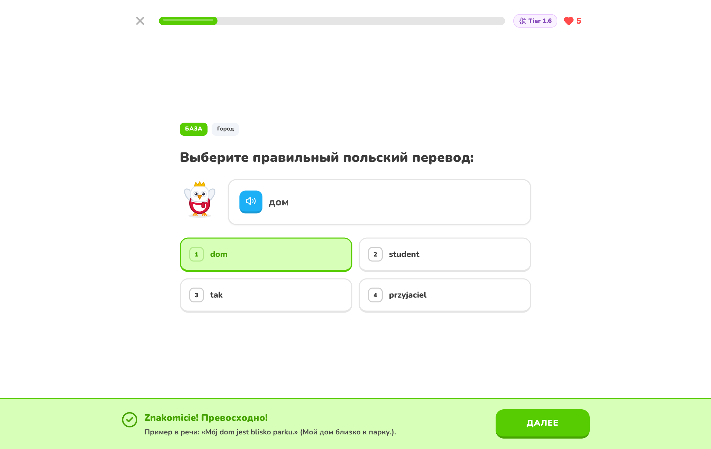
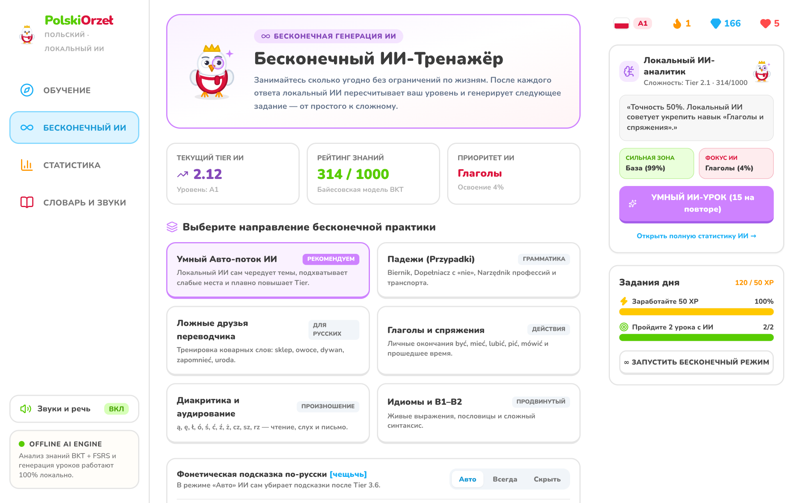
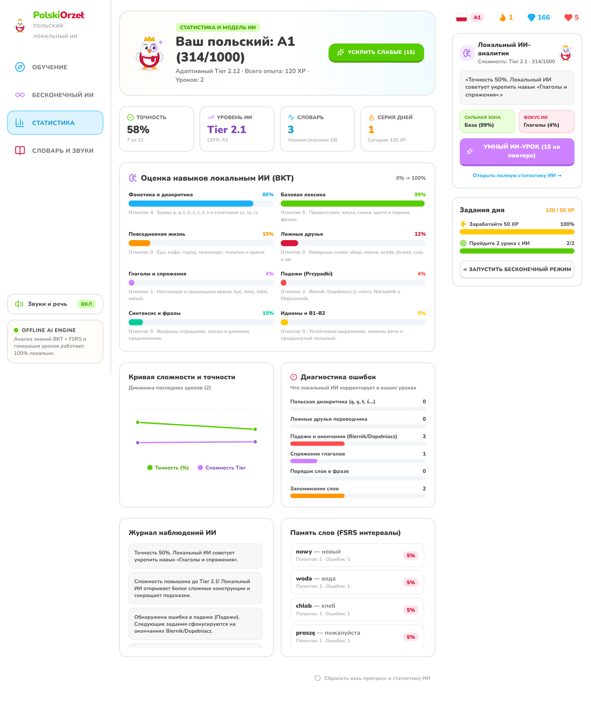
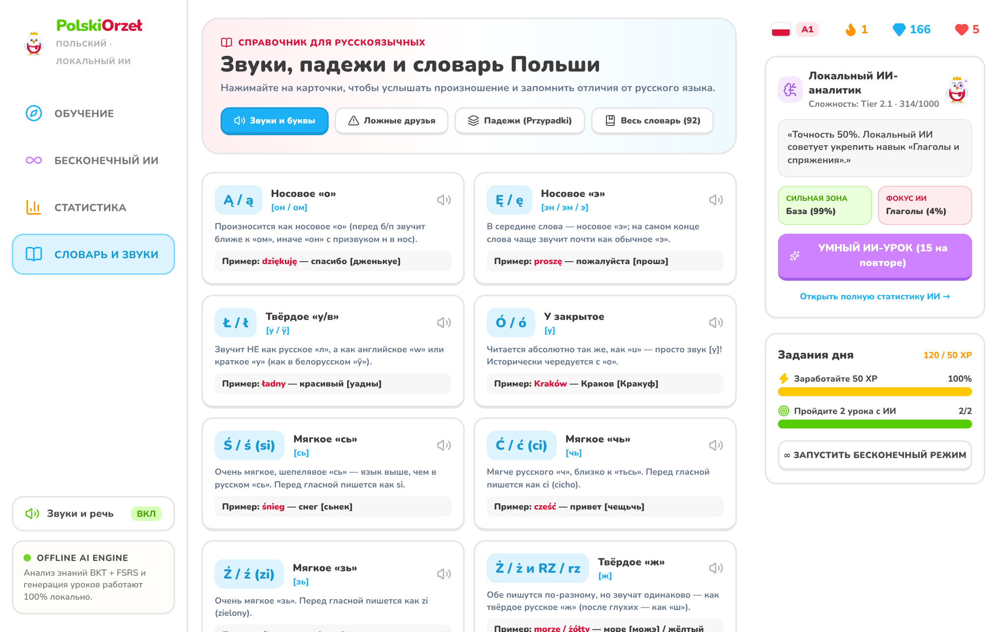
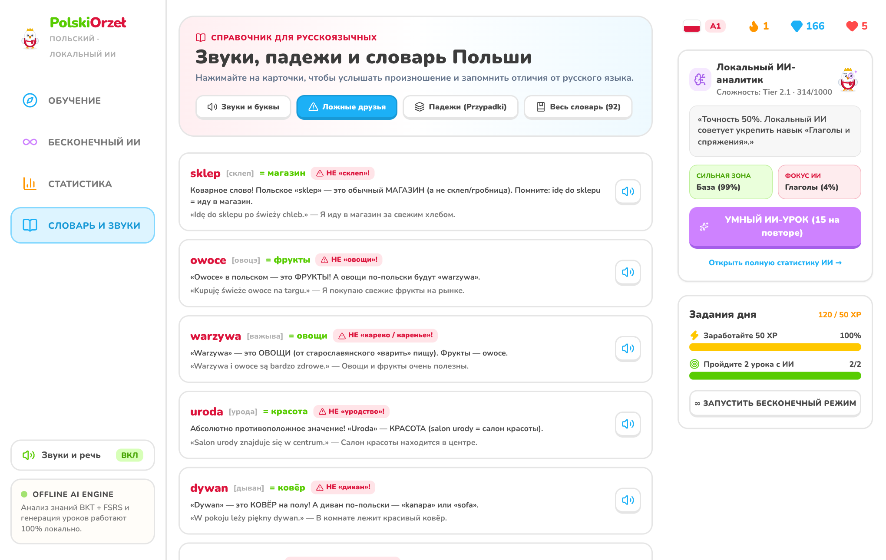

# 🦅 PolskiOrzeł — Польский язык с локальным ИИ (в стиле Duolingo)

Интерактивное веб-приложение в стиле **Duolingo** (шрифт **Nunito**, тактильные 3D-кнопки, маскот Орлик Белик, звуки и речь `pl-PL`), созданное для **русскоязычных**, изучающих польский язык.

Работает **100% офлайн/локально** — встроенный ИИ-движок анализирует уровень знаний в реальном времени и генерирует уроки на ходу.

---

## ✨ Возможности

- **Встроенный локальный ИИ-аналитик (BKT + FSRS + Адаптивный Tier 1.0 → 11.5)**:
  - Оценивает владение по **8 компетенциям**: Фонетика и диакритика, Базовая лексика, Быт, «Ложные друзья», Глаголы, Падежи (`Mianownik, Biernik, Dopełniacz, Narzędnik, Miejscownik`), Синтаксис и Идиомы B1–B2.
  - Прогнозирует интервалы повторения слов (FSRS) и рассчитывает общий рейтинг `0–1000` и уровень **CEFR (`A0 → C1`)**.
  - Классифицирует ошибки русскоязычных: пропуск польской диакритики (`ą, ę, ł, ó, ś, ć, ź, ż`), ловушки «ложных друзей» (`sklep ≠ склеп`, `owoce ≠ овощи`, `zapomnieć ≠ запомнить`), ошибки падежей (например, переход `Biernik → Dopełniacz` при отрицании `nie mam czasu`).
- **Прогрессивная сложность и бесконечная практика**:
  - **Карта обучения (5 разделов A0 → B2 + ∞)** с постепенным усложнением: от одиночных слов с русской транскрипцией `[чещьчь]` до сложных предложений и идиом без подсказок.
  - **Бесконечный ИИ-тренажёр**: занимайтесь бесконечно, сложность и тип заданий перестраиваются после *каждого* ответа.
  - **Быстрая ИИ-калибровка уровня**: 6-шаговый адаптивный тест для определения стартового уровня.
- **6 механик заданий**: выбор перевода, сборка фразы из плиток слов, ручной ввод с панелью польских букв (`ą ć ę ł ń ó ś ź ż`), грамматический пропуск (`cloze`), сопоставление пар и аудирование (`pl-PL`).
- **Бесконечные сердечки (`❤️ ∞`)**: учитесь и ошибайтесь без ограничений в любых уроках и режимах.
- **Статистика и справочник**: кривые прогресса, диагностика ошибок, интерактивный звуковой алфавит, таблица польских падежей и гид по «ложным друзьям».

---

## 📱 Android APK

Готовый скомпилированный APK-файл для установки на Android:
- [`polski-duo/release/PolskiOrzel.apk`](release/PolskiOrzel.apk) (собран через Capacitor 8 + Android Gradle из `polski-duo/android/`).

---

## 📸 Скриншоты

### Карта обучения и живой ИИ-аналитик


### Интерактивные задания и разбор от локального ИИ



### Бесконечный ИИ-тренажёр


### Статистика, кривая сложности и память слов (BKT + FSRS)


### Справочник звуков и «Ложные друзья переводчика»



---

## 🛠 Сборка и запуск

```bash
cd polski-duo
npm install
npm run build    # Скомпилированный бандл находится в dist/
npm run preview  # Предпросмотр собранного приложения
```
