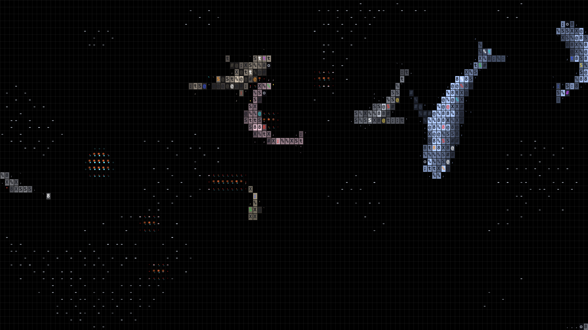

# ascii sharks

```
                            ;'
                             %%'
                              .t;.               .oooo
                               S;:S%              %8S8.
                                ;:tt%t '..        XX%%S
t'                            ''XSSS8SSX%XX8#.    %XSX%
 :;'               ;.''X8%8XX%%S%%S%SStt%tSX8S#X8't%ttt.
  ::%'       ''8XXXSSt%Stttttt%8@%%@%8@8%Sttt%%%%SSSSS%tt.
  'SXXtt%t%%%S%:;StS%ttSS%tSXSt88@@%8%@8%tStS%%X%SS%%S%;;t
 .@##88#@...'@@@@#@8@88X88#XXXSX8SX88SX8%SS%S%%S88St%t%%%.
  %;%t             :.    '.'##@###@X#888XX##8@@@#.X%XS%.
 .%t                            ;%%%#@@##@@@.     SXS%%
 t.                            .%;%%%.            %%XXS
                              '%t:t              .SXSS'
                             '::.                ooooo
                            .S'
                            .
```



Fish and sharks drawn as ASCII on a canvas. Zero runtime dependencies.

```sh
npm install && npm run dev
```

## Live demo controls

The dev page boots the engine full-screen with a control panel (press `H` to hide it):

- **14 species** — classic, hammerhead, great hammerhead, zebra, tiger, mako, thresher,
  nurse, whale, great white, blue, blacktip reef, epaulette, goblin. Toggle any of them;
  pick 1–16 sharks for the tank.
- **Fish density** — sparse, automatic (by area), or a dense bait ball.
- **Video length** — presets from 5 s to 60 s, or any value from 1 to 120 s.
- **Export** — records the canvas with `MediaRecorder` into WebM (VP9/VP8) or MP4 (H.264,
  where the browser supports it) at 1280×720, 1920×1080, 1080×1920 or 1080×1080, 30 or 60 fps.
  The recording runs in real time in a dedicated canvas at full resolution, then plays back
  in an overlay with a download button. Keep the tab in the foreground while it records.

URL parameters mirror the panel:
`?sharks=tiger,mako&count=6&fish=high&seconds=30&size=1920x1080&fps=30`

```ts
import { OceanEngine, SHARK_KINDS, makeSharkSpecs } from "./src";

const engine = new OceanEngine(canvas, [{ kind: "hammerhead", size: 1 }]);

// A whole mixed tank, sized by species:
new OceanEngine(canvas, makeSharkSpecs(SHARK_KINDS, 8), { fishCount: 300 });
```

MIT
