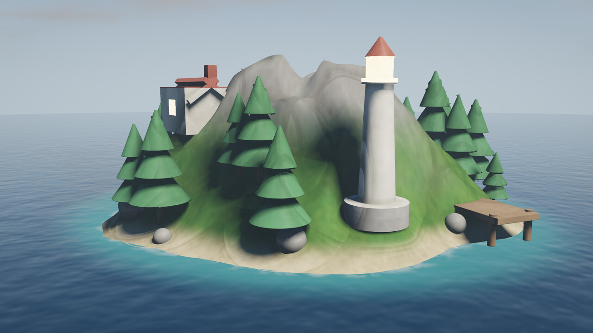
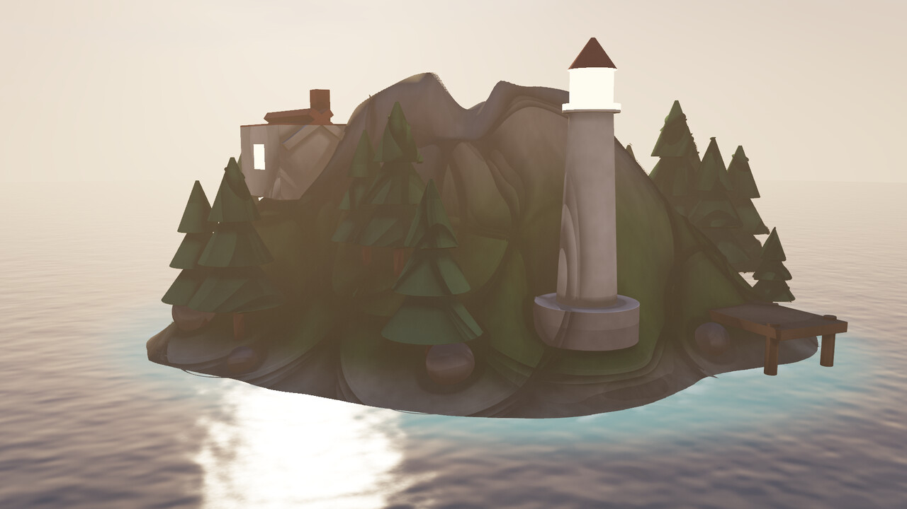
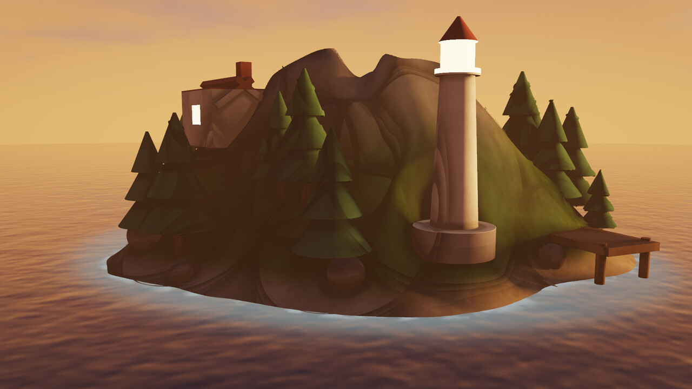
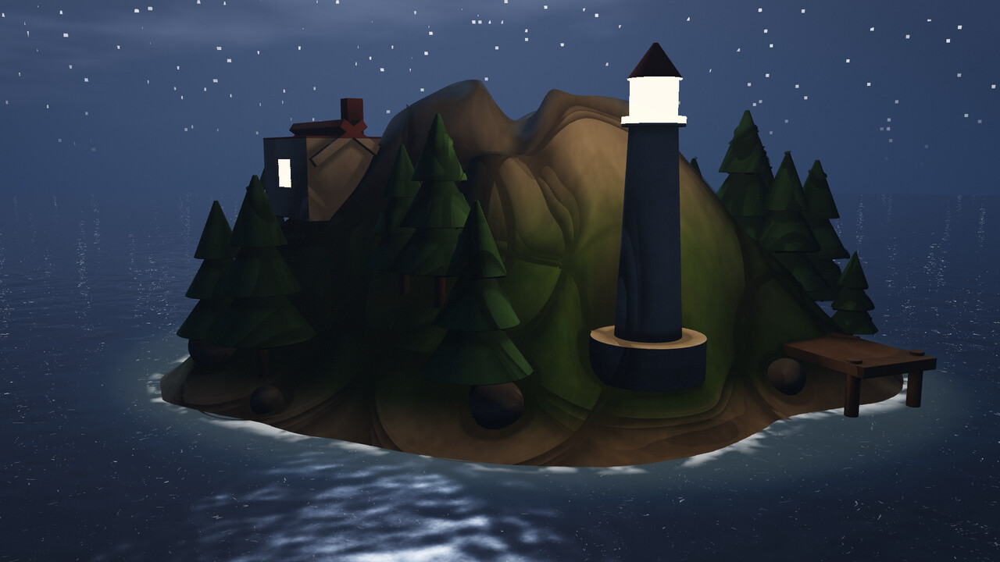

# world-render

Процедурный остров, нарисованный **CPU-рейкастером на чистом Rust**. Без GPU, без
внешних крейтов, без текстур, мешей и вообще каких-либо ассетов: всё —
математика и шум, вычисляемые в момент запуска.

Проект вырос из главы 1.2 книги «Язык программирования Rust» («Привет, мир!»):
тот же путь `rustc main.rs` → бинарник → результат на экране, только вместо одной
строки в терминале — 2 мегапикселя картинки.



| Рассвет | Закат | Ночь |
| --- | --- | --- |
|  |  |  |

## Быстрый старт

```bash
# Cargo
cd world-render
cargo run --release -- --preset day --out renders/day.png

# или совсем как в книге, без Cargo
rustc -O src/main.rs -o world-render
./world-render --preset sunset --width 1920 --height 1080 --samples 2
```

Готовый PNG лежит в `renders/`. Кодировщик PNG/deflate в проекте свой
(`src/png.rs`), поэтому никаких зависимостей нет вовсе.

## Использование

```
world-render [OPTIONS]

  --preset <name>    пресет освещения (по умолчанию dawn)
  --out <path>       .png или .ppm (по умолчанию renders/<preset>.png)
  --width <px>       ширина (по умолчанию 1280)
  --height <px>      высота (по умолчанию 720)
  --samples <1|2|3>  1, 4 или 9 лучей на пиксель (по умолчанию 2)
  --seed <n>         сид рельефа (по умолчанию 7)
  --serve            поднять интерактивное превью в браузере
  --port <port>      порт превью (по умолчанию 8080)
  --list-presets     показать пресеты
```

Пресеты: `dawn`, `day`, `sunset`, `night`. Каждый меняет положение и цвет солнца,
палитру неба и моря, туман, экспозицию, а ночью добавляет звёзды и зажигает фонарь
маяка.

Сид меняет остров: `--seed 1`, `--seed 42`, `--seed 2026` — разные хребты,
бухты и расстановка леса.

## Интерактивное превью

```bash
cargo run --release -- --serve --port 8080
# откройте http://localhost:8080
```

Сервер на `std::net` (тоже без зависимостей) отдаёт страницу и рисует картинку по
запросу `/api/render?preset=day&seed=7&width=960&height=540&samples=2`. В браузере
можно переключать время суток (кнопками или клавишами 1–4), менять сид, разрешение
и качество сглаживания.

## Как это устроено

| Файл | Что делает |
| --- | --- |
| `src/main.rs` | CLI, пресеты освещения, сборка сцены и камеры |
| `src/vec3.rs` | минимальный `Vec3` с операторами |
| `src/camera.rs` | камера-обскура, сетка субпиксельных сэмплов, PRNG |
| `src/world.rs` | шум, поле высот острова, SDF-примитивы, расстановка объектов |
| `src/render.rs` | реймарчинг, освещение, вода, небо, тонмаппинг |
| `src/png.rs` | PNG-кодировщик: CRC32, LZ77 + fixed-Huffman deflate |
| `src/server.rs` | мини- HTTP-сервер для превью |
| `web/index.html` | страница превью |

Коротко о рендере:

- **Рельеф.** `fbm` из value-noise строит эллиптическую маску острова, хребет
  (ridged noise), холмы и батиметрию. Поле высот запекается в сетку 1600×1600 и
  сэмплируется билинейно — это даёт точное расстояние до поверхности для
  трассировки.
- **Объекты.** Маяк, домик, сосны, валуны и причал — комбинации SDF-примитивов
  (боксы, цилиндры, конусы). Каждый объект обёрнут в ограничивающую сферу, чтобы
  не проверять далёкую геометрию.
- **Трассировка.** Sphere tracing с дроблением шага пополам, если луч «проскочил»
  сквозь крутой склон: это убирает тёмные пиксельные артефакты на хребтах.
- **Свет.** Тени считаются отдельно для рельефа (аналитический марш по полю высот)
  и для объектов (марш по SDF) — так пенумбра не «схлопывается» на первой ступени.
  Плюс hemisphere-ambient, ambient occlusion по distance field, блик и точечный
  источник в фонаре маяка.
- **Вода.** Плоскость `y = 0` с процедурными рябью, френелем, отражением неба,
  солнечной дорожкой, пеной у берега и просвечивающим дном на отмели.
- **Небо.** Градиент, облачный слой с двухслойным шумом, гало вокруг солнца, звёзды
  ночью. Экспозиция и ACES-тонмаппинг, виньетка и лёгкое зерно против бандинга.
- **Многопоточность.** Кадр режется на горизонтальные полосы, каждая считается в
  своём потоке через `std::thread::scope`.

## Тесты

```bash
cargo test --release
```

Проверяются: детерминированность и диапазон шума, наличие суши и моря, корректность
CRC у PNG-чанков, поток deflate и консервативность ограничивающих сфер (чтобы
маршер не мог «пролететь» сквозь объект).

## Ограничения

Рендер на CPU: 1280×720 при 4 лучах на пиксель — секунды, 1920×1080 — десятки
секунд. Это осознанный размен: одна команда `rustc` без зависимостей и никакого
GPU-контекста. Тени и вода — приближения, а не физически строгий путь.

## Лицензия

MIT.
