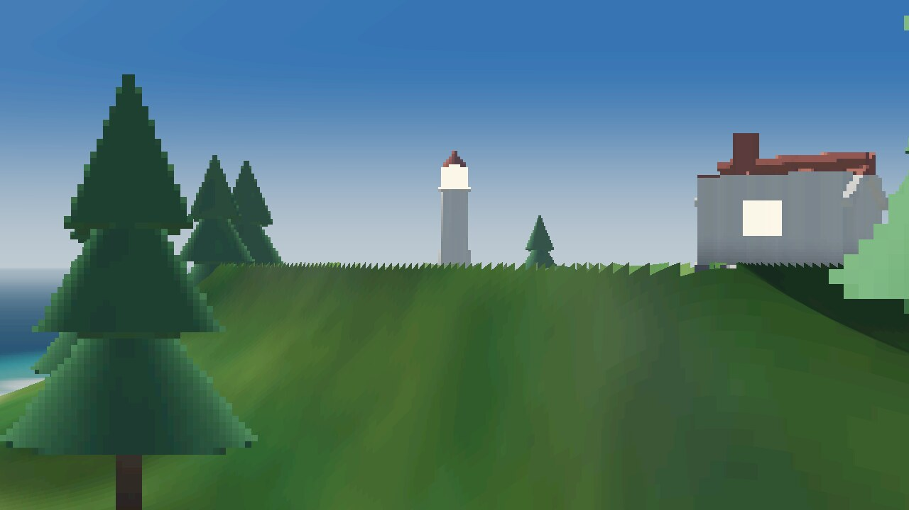
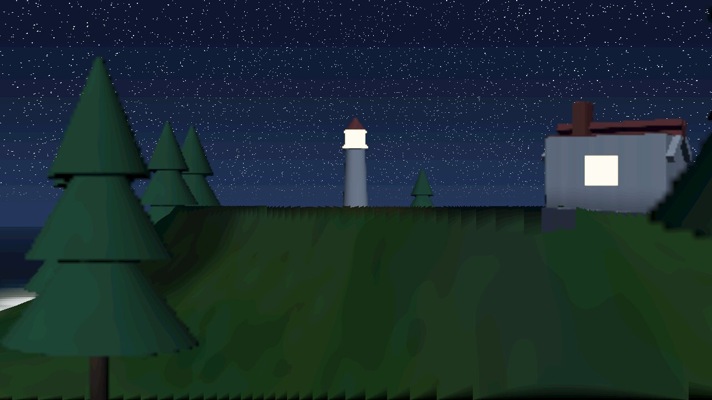

# world-render

Процедурный остров, нарисованный **CPU-рейкастером на чистом Rust**. Без GPU, без
внешних крейтов, без текстур, мешей и вообще каких-либо ассетов: всё —
математика и шум, вычисляемые в момент запуска.

Проект вырос из главы 1.2 книги «Язык программирования Rust» («Привет, мир!»):
тот же путь `rustc main.rs` → бинарник → результат на экране, только вместо одной
строки в терминале — 2 мегапикселя картинки.


| Рассвет | Закат | Ночь |
| --- | --- | --- |
|  |  |  |

## Быстрый старт

```bash
# Cargo
cd world-render
cargo run --release -- --preset day --out renders/day.png

# или совсем как в книге, без Cargo
rustc -O src/main.rs -o world-render
./world-render --preset sunset --width 1920 --height 1080 --samples 2
```

Готовый PNG лежит в `renders/`. Кодировщик PNG/deflate в проекте свой
(`src/png.rs`), поэтому никаких зависимостей нет вовсе.

## Использование

```
world-render [OPTIONS]

  --preset <name>    пресет освещения (по умолчанию dawn)
  --out <path>       .png или .ppm (по умолчанию renders/<preset>.png)
  --width <px>       ширина (по умолчанию 1280)
  --height <px>      высота (по умолчанию 720)
  --samples <1|2|3>  1, 4 или 9 лучей на пиксель (по умолчанию 2)
  --seed <n>         сид рельефа (по умолчанию 7)
  --serve            поднять интерактивное превью в браузере
  --walk-frame       нарисовать один кадр прогулки (отладка)
  --walk-seed <n>    сид мира для этого кадра
  --walk-pos x,z     поставить камеру в точку
  --walk-yaw <deg>   задать направление взгляда
  --port <port>      порт превью (по умолчанию 8080)
  --list-presets     показать пресеты
```

Пресеты: `dawn`, `day`, `sunset`, `night`. Каждый меняет положение и цвет солнца,
палитру неба и моря, туман, экспозицию, а ночью добавляет звёзды и зажигает фонарь
маяка.

Сид меняет остров: `--seed 1`, `--seed 42`, `--seed 2026` — разные хребты,
бухты и расстановка леса.

## Интерактивное превью

```bash
cargo run --release -- --serve --port 8080
# откройте http://localhost:8080
```

Сервер на `std::net` (тоже без зависимостей) отдаёт страницу и рисует картинку по
запросу `/api/render?preset=day&seed=7&width=960&height=540&samples=2`. В браузере
можно переключать время суток (кнопками или клавишами 1–4), менять сид, разрешение
и качество сглаживания.

## Прогулка по миру

Тот же остров можно обойти пешком от первого лица — прямо в браузере, без
установки чего-либо:

```bash
cargo run --release -- --serve --port 8080
# http://localhost:8080 → «Войти в мир»
```

Кнопка «Войти в мир» сразу открывает **полный экран без интерфейса**: на картинке
только мир, ни панелей, ни прицела. Если браузер не разрешает полный экран
(например, страница открыта во фрейме), мир всё равно занимает всё окно.

| Прогулка днём | Прогулка ночью |
| --- | --- |
|  |  |

**Управление**

| Клавиши | Действие |
| --- | --- |
| `W` `A` `S` `D` | идти (вперёд/влево/назад/вправо) |
| мышь | осмотреться (клик по сцене захватывает курсор) |
| `Shift` | бежать |
| `Space` | прыжок |
| `1`–`4` | рассвет / день / закат / ночь |
| `F` | полный экран вкл/выкл |
| `H` | показать/скрыть панели (чистый вид) |
| `P` | сохранить кадр в PNG в полном разрешении, без интерфейса |
| `Esc` | выйти из мира, вернуть панели |

Кнопки на панели делают то же самое: сменить время суток, «Новый мир» (другой
сид), «К берегу» (вернуться на точку старта) и выбрать качество картинки. Панели
видны только в меню и по клавише `H`: во время прогулки поверх мира ничего нет.

Шаг размеренный: 1.6 м/с (бег — 3.2 м/с), остров около 12 метров в поперечнике.
Разрешение подбирается само: кадр считается примерно на мегапиксель, и если
частота падает ниже 24 fps, разрешение тихо уменьшается, а когда машина
справляется — возвращается обратно. Во
время загрузки на экране прогресс: мир печётся один-два раза на CPU, потом
кадры идут под 30 fps.

По миру можно ходить, но не везде: в глубокую воду нельзя, на крутые склоны
тоже, деревья, валуны и стены домов — препятствия. Прыжок перепрыгивает
камешки и ступеньки, но не обрыв.

**Как это работает.** Полноценный рейкастер из `src/render.rs` рисует кадр
секундами — для прогулки это не годится. Поэтому у режима прогулки свой,
запечённый на старте конвейер (`src/walk.rs`):

- поле высот 700×700 сэмплируется как «voxel-space»: на каждый столбец
  экрана идёт один марш по горизонтали, без трассировки по пикселям; силуэт
  хребта уточняется бисекцией, а пролёты между шагами заливаются градиентом,
  чтобы склон не превращался в лесенку;
- цвет земли считается заранее в карту 768×768 (`ColourMap`): альбедо
  (трава/песок/камень/скала), свет солнца, склоновое затенение, пена у берега и
  мягкие тени от объектов на земле;
- небо — таблица 256×160 по (высота, азимут) от солнца, звёзды и диск
  солнца/луны дорисовываются по пикселям, чтобы не размывались;
- объекты — билборды: 16 ракурсов на каждый тип (сосна, домик, маяк, валун,
  причал) запекаются маршем по SDF в спрайт 176×176 с картой глубины
  (`delta`), поэтому билборд корректно пересекается с рельефом по z-буферу;
  вблизи спрайты фильтруются билинейно (маска работает как альфа), иначе
  крупный план рассыпается на квадраты;
- вода — отдельный шейдер по глубине: бирюзовая отмель, синяя глубина,
  отражение неба на горизонте, солнечная дорожка и пена с шумом;
- в конце — тонмаппинг через таблицу (`ToneLut`) и дизеринг.

Итого кадр 640×360 считается за ~10 мс: запекание 1.5–2 с один раз, дальше
только рендер.

**Сборка WebAssembly.** Модуль собирается обычным `rustc`, без wasm-bindgen и
wasm-pack:

```bash
rustup target add wasm32-unknown-unknown
bash tools/build_wasm.sh
# built web/wasm/world_render.wasm (~136 КБ, -C strip=symbols)
```

Бинарник сервера встраивает готовый `.wasm` через `include_bytes!`, поэтому
после пересборки модуля надо пересобрать и `cargo build --release`. Страница
общается с модулем через обычные C-экспорты (`wr_init`, `wr_bake_step`,
`wr_frame`, `wr_input`, `wr_look`, `wr_player_x` и т.д., см. `src/wasm.rs`) и
рисует кадр из RGBA-буфера в `ImageData` — никаких JS-привязок не требуется.

**Отладка одного кадра.** Прогулку можно отрисовать из терминала в PNG, не
открывая браузер:

```bash
# вид со стартовой точки
./target/release/world-render --walk-frame --preset day --out /tmp/walk.png

# встать в точку и посмотреть на домик
./target/release/world-render --walk-frame --preset sunset \
    --walk-pos -2.1,5.2 --walk-yaw 4 --width 1280 --height 720 --out /tmp/cottage.png

# «полный скрин» без интерфейса — просто кадр в полном разрешении
./target/release/world-render --walk-frame --preset day \
    --width 1920 --height 1080 --out renders/walk-1920.png
```

Кадр из терминала — это ровно то, что видно в браузере: HUD и панели живут
только в `web/index.html`, рендер их не знает. Направление взгляда
(`--walk-yaw`) — в градусах, `0` смотрит на `-Z` (на север по карте). Вертикальный угол обзора 68°, глаза камеры на 1.62 м над
землёй. `WR_WALK_DEBUG=1` печатает
итоговую позицию камеры и высоту земли под ней.

## Как это устроено

| Файл | Что делает |
| --- | --- |
| `src/main.rs` | CLI, пресеты освещения, сборка сцены и камеры |
| `src/vec3.rs` | минимальный `Vec3` с операторами |
| `src/camera.rs` | камера-обскура, сетка субпиксельных сэмплов, PRNG |
| `src/world.rs` | шум, поле высот острова, SDF-примитивы, расстановка объектов |
| `src/render.rs` | реймарчинг, освещение, вода, небо, тонмаппинг |
| `src/walk.rs` | быстрый рендер для прогулки: запечённые карты, билборды, игрок и коллизии |
| `src/wasm.rs` | экспорты для WebAssembly: сессия, ввод, кадр, ошибки |
| `src/presets.rs` | пресеты освещения, общие для картинки, прогулки и wasm |
| `src/png.rs` | PNG-кодировщик: CRC32, LZ77 + fixed-Huffman deflate |
| `src/server.rs` | мини- HTTP-сервер для превью |
| `web/index.html` | страница: статичное превью и режим прогулки |
| `tools/build_wasm.sh` | сборка `web/wasm/world_render.wasm` одним `rustc` |

Коротко о рендере:

- **Рельеф.** `fbm` из value-noise строит эллиптическую маску острова, хребет
  (ridged noise), холмы и батиметрию. Поле высот запекается в сетку 1600×1600 и
  сэмплируется билинейно — это даёт точное расстояние до поверхности для
  трассировки.
- **Объекты.** Маяк, домик, сосны, валуны и причал — комбинации SDF-примитивов
  (боксы, цилиндры, конусы). Каждый объект обёрнут в ограничивающую сферу, чтобы
  не проверять далёкую геометрию.
- **Трассировка.** Sphere tracing с дроблением шага пополам, если луч «проскочил»
  сквозь крутой склон: это убирает тёмные пиксельные артефакты на хребтах.
- **Свет.** Тени считаются отдельно для рельефа (аналитический марш по полю высот)
  и для объектов (марш по SDF) — так пенумбра не «схлопывается» на первой ступени.
  Плюс hemisphere-ambient, ambient occlusion по distance field, блик и точечный
  источник в фонаре маяка.
- **Вода.** Плоскость `y = 0` с процедурными рябью, френелем, отражением неба,
  солнечной дорожкой, пеной у берега и просвечивающим дном на отмели.
- **Небо.** Градиент, облачный слой с двухслойным шумом, гало вокруг солнца, звёзды
  ночью. Экспозиция и ACES-тонмаппинг, виньетка и лёгкое зерно против бандинга.
- **Многопоточность.** Кадр режется на горизонтальные полосы, каждая считается в
  своём потоке через `std::thread::scope`.

## Тесты

```bash
cargo test --release
```

Проверяются: детерминированность и диапазон шума, наличие суши и моря, корректность
CRC у PNG-чанков, поток deflate и консервативность ограничивающих сфер (чтобы
маршер не мог «пролететь» сквозь объект), а также то, что игрок может сойти с
точки старта, а дома стоят на земле, а не висят над ней.

## Ограничения

Статичный рендер на CPU: 1280×720 при 4 лучах на пиксель — секунды, 1920×1080 —
десятки секунд. Режим прогулки — отдельный, упрощённый конвейер (см. выше): он
торгует точностью теней и отражений за интерактивность. Это осознанный размен: одна команда `rustc` без зависимостей и никакого
GPU-контекста. Тени и вода — приближения, а не физически строгий путь.

## Свои кадры

```bash
cargo run --release -- --seed 2026 --preset sunset --width 1600 --height 900 --samples 3
```

Пресеты можно смотреть прямо из терминала:

```bash
cargo run --release -- --list-presets
```

## Лицензия

MIT.
